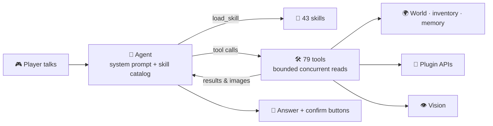
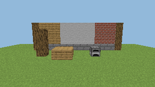

<div align="right">

🌐 [简体中文](README.md) · **English**

</div>

<div align="center">

# 🐼 PandaGPT

### A zero-command AI agent for Minecraft

**It sees, remembers, looks things up and reminds you. Players just talk.**

[](https://papermc.io/)
[](https://adoptium.net/)
[](https://github.com/obsidianplusplus/PandaGPT)
[](https://github.com/obsidianplusplus/PandaGPT/actions)
<br/>


[✨ Highlights](#-highlights) · [🎬 Demo](#-a-conversation) · [🚀 Quick start](#-quick-start) · [🤖 Models](#-supported-models) · [🧩 Features](#-features) · [🔌 Plugins](#-plugin-ecosystem) · [📚 Wiki](docs/wiki/en/Home.md) · [📝 Changelog](CHANGELOG.en.md)

</div>

---

## ✨ Highlights

<table>
<tr>
<td width="33%" valign="top">

### 🗣️ Zero commands
Players have no commands at all. Start a chat message with `panda`, talk like you would to a friend, and the agent handles the rest.

</td>
<td width="33%" valign="top">

### 🧠 A real agent
A multi-step, parallel tool-calling loop with 79 tools and 43 on-demand skills. It decides whether to look, search or ask first. A session runtime lets the model maintain a plan, interpret current activity and schedule bounded rechecks by time or changed state.

</td>
<td width="33%" valign="top">

### 👁️ It can see
No client mod needed: the server reconstructs the player's view with raycasting and vanilla textures, so "that furnace over there" just works.

</td>
</tr>
<tr>
<td valign="top">

### 🔔 Knows when to stay quiet
Proactive tips are checked before they're sent, strictly rate-limited and deduplicated. Most of the time it chooses silence.

</td>
<td valign="top">

### 🔌 Knows your server
Hooks into 19 plugins such as Vault, LuckPerms, WorldGuard, Towny and Essentials, and reaches many more through PlaceholderAPI.

</td>
<td valign="top">

### 🛡️ Safe by design
Every state change needs the player's confirmation and runs as that player. Work is bounded and backs off when the server is busy.

</td>
</tr>
</table>

## 🎬 A conversation

```text
<Steve> panda how do I use that furnace on the left?
  👀 Looking…
[Panda] #3 on your left is a furnace (outlined with particles). Ore goes on top, fuel below,
        results on the right. You have 12 raw iron and 5 coal: enough for 12 ingots.

<Steve> panda I want an iron pickaxe
[Panda] Goal set. You still need 2 sticks; you have planks, so craft them at a table.

<Steve> panda design a small 7×7 cabin here
  🏗 Building a preview…
[Panda] The preview is in front of you (only you can see it). It needs 96 oak planks,
        24 cobblestone and 4 glass; you're 31 planks short. Shall I make that a goal?

               (night falls, Steve is 230 blocks away)
[Panda] It's getting dark. Home is 230 blocks north-east. Want me to guide you?

<Steve> panda take me home
[Panda] 🧭 home ↗ 230 blocks · height +8
```

## 🚀 Quick start

> Requirements: **Paper 26.3** · **Java 25** · an API key for a model with tool calling

**1. Install**: put `PandaGPT-3.2.0.jar` in `plugins/` and restart.

**2. Add a key**: edit `plugins/PandaGPT/config.yml`

```yaml
panda:
  model_selection:
    provider: 'openai'     # openai gemini anthropic deepseek qwen moonshot zhipu doubao …
    openai:
      api_key: 'sk-...'    # or the PANDAGPT_OPENAI_API_KEY environment variable
```

**3. Reload**: `/pandaadmin reload`, then say `panda hello` in chat.

> 🖼️ The vanilla textures needed for vision are **downloaded from Mojang by the plugin itself**, with SHA-1 verification at every step. No scripts needed.

📖 Full guide: [Installation & Upgrading](docs/wiki/en/Installation.md)

## 🤖 Supported models

<table>
<tr><th>International</th><th>China</th><th>Other</th></tr>
<tr>
<td valign="top">

- **OpenAI** GPT
- **Google** Gemini
- **Anthropic** Claude (native API)
- **Azure** OpenAI
- **xAI** Grok
- **Mistral** AI
- **Groq**

</td>
<td valign="top">

- **DeepSeek**
- **Qwen** (Alibaba Cloud Model Studio)
- **Kimi** (Moonshot AI)
- **Zhipu GLM**
- **Doubao** (Volcengine Ark)
- **SiliconFlow**

</td>
<td valign="top">

- **OpenRouter** (one key, hundreds of models)
- **Any OpenAI-compatible endpoint** (vLLM, LiteLLM, One API…)

</td>
</tr>
</table>

Models without image input work too: with `vision` off, vision results reach the model as text. 📖 [Model Providers](docs/wiki/en/Model-Providers.md)

## 🧩 Features

| | Feature | Try saying |
|:---:|---|---|
| 🧭 | **Task plans and bounded follow-ups** | "Help me prepare for the Nether; follow up if useful" · "Leave that for now and look here" |
| 🧠 | **Game memory & distillation** | "why did I die last time?" · "remember this lesson" · "organize my memories" |
| 📍 | **Place memory & guidance** | "remember this as home" · "take me home" |
| 👁️ | **Vision & object pointing** | "what's in front of me?" · "how do I use that furnace on the left?" |
| ⚒️ | **Goals & real recipes** | "I want an iron pickaxe" · "what can I craft now?" |
| 🏗️ | **Ghost-block building preview** | "design a 7×7 cabin here" |
| ⏰ | **Reminders** | "remind me to harvest wheat in ten minutes" · "tell me to go home before dark" |
| 💀 | **Death recall** | "where did I just die? Is my stuff still there?" |
| 📊 | **Statistics & advancements** | "how many diamonds did I mine today?" · "what advancement next?" |
| 📝 | **Personal notes** | "note that I like Japanese-style builds" |
| 🗡️ | **Items & trades** | "how long will this sword last?" · "who sells Mending nearby?" |
| 📚 | **Server knowledge** | "can I claim land here?" |
| ⚡ | **Command proposals** | "take me to spawn" → click Confirm |
| 🔔 | **Proactive tips** | One useful sentence when materials are ready, you're far from home at night, or drops are about to despawn |

📖 [Talking to Panda](docs/wiki/en/Talking-to-Panda.md) · [Creative Features](docs/wiki/en/Creative-Features.md) · [Agent & Tools](docs/wiki/en/Agent-and-Tools.md)

## 🔌 Plugin ecosystem

Install a plugin and it just works; missing plugins hide themselves. No configuration:

| 💰 Vault | 🧩 PlaceholderAPI | 🎖️ LuckPerms | 🛡️ WorldGuard | 🏡 GriefPrevention | 🏰 Towny |
|:---:|:---:|:---:|:---:|:---:|:---:|
| **🗺️ Lands** | **🏠 EssentialsX** | **🕵️ CoreProtect** | **⚔️ mcMMO** | **✨ AuraSkills** | **🧑 Citizens** |
| **🛒 Shopkeepers** | **📜 Quests** | **🏝️ BentoBox** | **🎨 ItemsAdder** | **🧰 Oraxen** | **⛏️ Jobs Reborn** |
| **🌐 Multiverse-Core 5** | **➕ PAPI expansions** | | | | |

Native adapters now cover NPCs, shop trading sessions, quest stages, islands, custom items, professions and multiple worlds. Other gameplay plugins can still use PlaceholderAPI and server docs. 📖 [Plugin Integrations](docs/wiki/en/Plugin-Integrations.md)

## 🏗️ How it works



- **The task runtime** lets AI choose a plan, recheck conditions and routine proactive messages. Defaults allow 3 automatic follow-up turns per request, each potentially using multiple model calls. Working plans do not survive restart. 📖 [Agent Runtime](docs/wiki/en/Agent-Runtime.md)
- **Skills** are Markdown files you can edit, add or disable; only the catalog sits in the system prompt and full text loads on demand. 📖 [Skills & Prompts](docs/wiki/en/Skills-and-Prompts.md)
- **Bukkit access stays on the main thread**; model requests, file I/O and asynchronous waits use background workers. World sampling shares a default 2 ms soft budget per tick and backs off under load. 📖 [Performance](docs/wiki/en/Performance.md)
- **Commands are never executed automatically**; they can only be proposed and confirmed by the player. 📖 [Command Proposals](docs/wiki/en/Command-Proposals.md)

<div align="center">



<sub>Server-side raycast reconstruction with vanilla textures (synthetic validation scene, not a server screenshot)</sub>

</div>

## 📚 Documentation

<table>
<tr>
<td valign="top">

**Getting started**
- 📦 [Installation](docs/wiki/en/Installation.md)
- 🤖 [Model Providers](docs/wiki/en/Model-Providers.md)
- 💬 [Talking to Panda](docs/wiki/en/Talking-to-Panda.md)

</td>
<td valign="top">

**How it works**
- 🧠 [Agent & Tools](docs/wiki/en/Agent-and-Tools.md)
- 🧭 [Agent Runtime](docs/wiki/en/Agent-Runtime.md)
- 🧠 [Game Memory & Distillation](docs/wiki/en/Game-Memory.md)
- 📜 [Skills & Prompts](docs/wiki/en/Skills-and-Prompts.md)
- 🔔 [Proactive Assistant](docs/wiki/en/Proactive-Assistant.md)
- 👁️ [Vision & Perception](docs/wiki/en/Vision-and-Perception.md)

</td>
<td valign="top">

**Gameplay**
- ✨ [Creative Features](docs/wiki/en/Creative-Features.md)
- 🔌 [Plugin Integrations](docs/wiki/en/Plugin-Integrations.md)
- ⚡ [Command Proposals](docs/wiki/en/Command-Proposals.md)

</td>
<td valign="top">

**Operations**
- ⚙️ [Configuration](docs/wiki/en/Configuration.md)
- 🌍 [Languages](docs/wiki/en/Languages.md)
- 🔑 [Permissions & Admin](docs/wiki/en/Permissions-and-Admin.md)
- 🚀 [Performance](docs/wiki/en/Performance.md)
- 🛡️ [Privacy & Security](docs/wiki/en/Privacy-and-Security.md)
- ❓ [FAQ](docs/wiki/en/FAQ.md)
- 🛠️ [Development](docs/wiki/en/Development.md)

</td>
</tr>
</table>

## 🔑 Permissions

| Permission | Default | Purpose |
|---|:---:|---|
| `pandagpt.use` | everyone | Talk to Panda |
| `pandagpt.actions` | OP | Confirm command proposals |
| `pandagpt.vision` | OP | Vision and background observation |
| `pandagpt.vision.debug` | OP | Debug particles |
| `pandagpt.blockhistory` | OP | CoreProtect lookups |
| `pandagpt.admin` | OP | `/pandaadmin reload · status · clearchat` |

## 🛠️ Building

```bash
mvn --batch-mode --no-transfer-progress clean verify
```

Output: `target/PandaGPT-3.2.0.jar`. 📖 [Development](docs/wiki/en/Development.md)

---

<div align="center">

<sub>Made with 🐼 for Minecraft servers · <a href="README.md">阅读中文版</a></sub>

</div>
