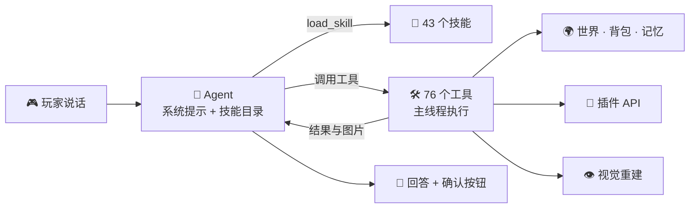

<div align="right">

🌐 **简体中文** · [English](README.en.md)

</div>

<div align="center">

# 🐼 PandaGPT

### 零命令的 Minecraft AI Agent

**能看 · 能记 · 会查 · 会提醒，玩家只需要说话。**

[](https://papermc.io/)
[](https://adoptium.net/)
[](https://github.com/obsidianplusplus/PandaGPT)
[](https://github.com/obsidianplusplus/PandaGPT/actions)
<br/>


[✨ 亮点](#-亮点) · [🎬 体验](#-一段对话) · [🚀 快速开始](#-快速开始) · [🤖 模型](#-支持的模型) · [🧩 功能](#-功能全景) · [🔌 插件](#-插件生态) · [📚 Wiki](docs/wiki/zh/Home.md) · [📝 更新日志](CHANGELOG.md)

</div>

---

## ✨ 亮点

<table>
<tr>
<td width="33%" valign="top">

### 🗣️ 零命令
玩家没有任何命令。在聊天开头说 `panda`，像跟朋友说话一样，剩下的交给 Agent。

</td>
<td width="33%" valign="top">

### 🧠 真正的 Agent
多步、并行的工具调用循环，76 个工具、43 个技能按需加载，自己决定先看、先查还是先问。

</td>
<td width="33%" valign="top">

### 👁️ 看得见
不需要客户端模组，在服务器端用射线与原版纹理重建玩家眼前的画面，指着说“那个熔炉”也能懂。

</td>
</tr>
<tr>
<td valign="top">

### 🔔 懂分寸
主动提醒先核实再开口，严格限频、去重，大多数时候选择安静。

</td>
<td valign="top">

### 🔌 懂你的服务器
对接 Vault、LuckPerms、WorldGuard、Towny、Essentials 等 19 个插件，并通过 PlaceholderAPI 覆盖更多。

</td>
<td valign="top">

### 🛡️ 安全可控
所有改变状态的操作都需要玩家确认，以玩家身份执行；工作量有界，服务器忙时自动退让。

</td>
</tr>
</table>

## 🎬 一段对话

```text
<Steve> panda 左边那个熔炉怎么用？
  👀 正在看…
[Panda] 你左边的 #3 是熔炉（已用粒子圈出）。上面放矿石，下面放燃料，右边取成品。
        你背包里有 12 个粗铁和 5 个煤，够烧 12 个铁锭。

<Steve> panda 我想做一把铁镐
[Panda] 已设为目标。还差 2 根木棍；你有木板，在工作台上合成就行。

<Steve> panda 在这里给我设计一个 7×7 的小木屋
  🏗 正在搭建预览…
[Panda] 预览已放在你面前（只有你看得见）。需要 96 个橡木木板、24 个圆石、4 块玻璃，
        你还差 31 个木板。要我把它设为目标吗？

               （天黑了，Steve 还在 230 格外）
[Panda] 天黑了，家在东北方 230 格，要我带路吗？

<Steve> panda 带我回家
[Panda] 🧭 家 ↗ 230 格 · 高差 +8
```

## 🚀 快速开始

> 环境：**Paper 26.3** · **Java 25** · 一个支持工具调用的模型 API 密钥

**1. 安装**：把 `PandaGPT-3.2.0.jar` 放进 `plugins/` 并重启。

**2. 填写密钥**：编辑 `plugins/PandaGPT/config.yml`

```yaml
panda:
  model_selection:
    provider: 'deepseek'   # openai gemini anthropic deepseek qwen moonshot zhipu doubao …
    deepseek:
      api_key: 'sk-...'    # 或使用环境变量 PANDAGPT_DEEPSEEK_API_KEY
```

**3. 重载**：`/pandaadmin reload`，然后在聊天里说 `panda 你好`。

> 🖼️ 视觉所需的原版纹理由插件**自动从 Mojang 官方下载**，并逐层校验 SHA-1，无需任何脚本。

📖 详细步骤：[安装与升级](docs/wiki/zh/Installation.md)

## 🤖 支持的模型

<table>
<tr><th>国际</th><th>国内</th><th>其他</th></tr>
<tr>
<td valign="top">

- **OpenAI** GPT
- **Google** Gemini
- **Anthropic** Claude（原生接口）
- **Azure** OpenAI
- **xAI** Grok
- **Mistral** AI
- **Groq**

</td>
<td valign="top">

- **DeepSeek** 深度求索
- **通义千问**（阿里云百炼）
- **Kimi**（月之暗面）
- **智谱 GLM**
- **豆包**（火山方舟）
- **硅基流动**

</td>
<td valign="top">

- **OpenRouter**（一个密钥，数百个模型）
- **任意 OpenAI 兼容接口**（vLLM、LiteLLM、One API…）

</td>
</tr>
</table>

不支持图片的模型也能用：关闭 `vision` 后，视觉结果以文字形式交给模型。📖 [模型服务商](docs/wiki/zh/Model-Providers.md)

## 🧩 功能全景

| | 功能 | 你可以这样说 |
|:---:|---|---|
| 🧠 | **游戏记忆与记忆蒸馏** | “上次我为什么死了？” · “记住这次教训” · “整理我的记忆” |
| 📍 | **地点记忆与导航** | “记住这里是我家” · “带我回家” |
| 👁️ | **视觉重建与对象指认** | “我面前这是什么？” · “左边那个熔炉怎么用？” |
| ⚒️ | **目标与真实配方** | “我想做一把铁镐” · “我现在能做什么？” |
| 🏗️ | **幽灵建筑预览** | “在这里设计一个 7×7 的木屋” |
| ⏰ | **提醒** | “十分钟后提醒我收麦子” · “天黑前叫我回家” |
| 💀 | **死亡回溯** | “我刚死在哪？东西还在吗？” |
| 📊 | **统计与成就** | “我今天挖了多少钻石？” · “下一步做什么成就？” |
| 📝 | **个人笔记** | “记一下我喜欢中式建筑” |
| 🗡️ | **物品与交易** | “这把剑还能用多久？” · “附近谁卖经验修补？” |
| 📚 | **服务器资料** | “本服能圈地吗？” |
| ⚡ | **命令提案** | “帮我回出生点” → 点击确认 |
| 🔔 | **主动提醒** | 材料齐了、入夜远离家、死亡后物品将消失时，说一句有用的话 |

📖 [和 Panda 对话](docs/wiki/zh/Talking-to-Panda.md) · [创意功能](docs/wiki/zh/Creative-Features.md) · [Agent 与工具](docs/wiki/zh/Agent-and-Tools.md)

## 🔌 插件生态

装了就能用，没装自动隐藏，无需配置：

| 💰 Vault | 🧩 PlaceholderAPI | 🎖️ LuckPerms | 🛡️ WorldGuard | 🏡 GriefPrevention | 🏰 Towny |
|:---:|:---:|:---:|:---:|:---:|:---:|
| **🗺️ Lands** | **🏠 EssentialsX** | **🕵️ CoreProtect** | **⚔️ mcMMO** | **✨ AuraSkills** | **🧑 Citizens** |
| **🛒 Shopkeepers** | **📜 Quests** | **🏝️ BentoBox** | **🎨 ItemsAdder** | **🧰 Oraxen** | **⛏️ Jobs Reborn** |
| **🌐 Multiverse-Core 5** | **➕ PAPI 扩展** | | | | |

新增 NPC、商店交易会话、任务阶段、空岛、自定义物品、职业与多世界原生适配。其他玩法仍可通过 PlaceholderAPI 与服务器资料扩展。📖 [插件集成](docs/wiki/zh/Plugin-Integrations.md)

## 🏗️ 工作原理



- **技能**是 Markdown 文件，服主可以修改、新增或关闭；系统提示只放目录，模型按需加载全文。📖 [技能与提示词](docs/wiki/zh/Skills-and-Prompts.md)
- **所有工具在服务器主线程执行**，AI 请求在独立线程，每 tick 有 2 ms 的共享预算，负载高时自动退让。📖 [性能](docs/wiki/zh/Performance.md)
- **命令永远不会被自动执行**，只能提案并由玩家确认。📖 [命令提案](docs/wiki/zh/Command-Proposals.md)

<div align="center">


<sub>服务器端射线重建 + 原版纹理（人工构造的验证场景，非服务器截图）</sub>

</div>

## 📚 文档

<table>
<tr>
<td valign="top">

**入门**
- 📦 [安装与升级](docs/wiki/zh/Installation.md)
- 🤖 [模型服务商](docs/wiki/zh/Model-Providers.md)
- 💬 [和 Panda 对话](docs/wiki/zh/Talking-to-Panda.md)

</td>
<td valign="top">

**核心机制**
- 🧠 [Agent 与工具](docs/wiki/zh/Agent-and-Tools.md)
- 🧠 [游戏记忆与记忆蒸馏](docs/wiki/zh/Game-Memory.md)
- 📜 [技能与提示词](docs/wiki/zh/Skills-and-Prompts.md)
- 🔔 [主动式助手](docs/wiki/zh/Proactive-Assistant.md)
- 👁️ [视觉与感知](docs/wiki/zh/Vision-and-Perception.md)

</td>
<td valign="top">

**玩法与生态**
- ✨ [创意功能](docs/wiki/zh/Creative-Features.md)
- 🔌 [插件集成](docs/wiki/zh/Plugin-Integrations.md)
- ⚡ [命令提案](docs/wiki/zh/Command-Proposals.md)

</td>
<td valign="top">

**运维**
- ⚙️ [配置参考](docs/wiki/zh/Configuration.md)
- 🌍 [多语言](docs/wiki/zh/Languages.md)
- 🔑 [权限与管理](docs/wiki/zh/Permissions-and-Admin.md)
- 🚀 [性能](docs/wiki/zh/Performance.md)
- 🛡️ [安全与隐私](docs/wiki/zh/Privacy-and-Security.md)
- ❓ [常见问题](docs/wiki/zh/FAQ.md)
- 🛠️ [开发指南](docs/wiki/zh/Development.md)

</td>
</tr>
</table>

## 🔑 权限一览

| 权限 | 默认 | 用途 |
|---|:---:|---|
| `pandagpt.use` | 所有人 | 和 Panda 说话 |
| `pandagpt.actions` | OP | 确认命令提案 |
| `pandagpt.vision` | OP | 视觉重建与后台观察 |
| `pandagpt.vision.debug` | OP | 调试粒子 |
| `pandagpt.blockhistory` | OP | 查询 CoreProtect 记录 |
| `pandagpt.admin` | OP | `/pandaadmin reload · status · clearchat` |

## 🛠️ 构建

```bash
mvn --batch-mode --no-transfer-progress clean verify
```

产物：`target/PandaGPT-3.2.0.jar`。📖 [开发指南](docs/wiki/zh/Development.md)

---

<div align="center">

<sub>Made with 🐼 for Minecraft servers · <a href="README.en.md">Read in English</a></sub>

</div>
