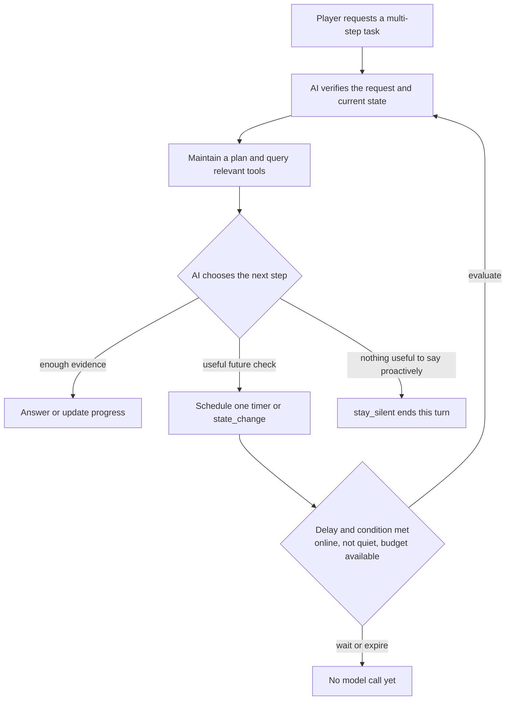

<!-- nav:top -->
<div align="right">

🌐 [简体中文](../zh/Agent-Runtime.md) · **English** · 📖 [README](../../../README.en.md) · 🏠 [Wiki home](Home.md)

</div>
<!-- /nav:top -->

# 🧭 Agent Runtime

The runtime lets Panda maintain a plan for an actual multi-step player request, revise it using new evidence and decide whether to recheck, speak or stay quiet. The model chooses the objective, steps, relevant tools and next check; the plugin enforces execution boundaries, budgets, permissions and cancellation.

Simple questions can still receive direct answers without a plan. The runtime does not execute game commands on its own, and a completed step cannot replace evidence from tools or the game world.

## What players can say

```text
<Steve> panda help me prepare for the Nether; check my equipment and supplies and follow up if useful
[Panda] I'll check your equipment, food and fire protection, then explain any gaps.

...an explicitly scheduled check becomes due and its conditions are met...
[Panda] Your food supplies are ready; next check fire protection and your return route.

<Steve> panda leave the Nether plan for now and look at this block
[Panda] I'll look at the block in front of you first.

<Steve> panda don't disturb me
[Panda] Quiet mode is on.
```

These are illustrative responses, not fixed scripts or a promise to follow up every time. The model must query real data and may send nothing when evidence or useful progress is missing. A new question from the same player cancels the older background turn and pending check; the old plan can still help the new turn understand context.

## From request to reevaluation



Working state contains the original player request, one objective, 1–8 steps, progress, the model's activity interpretation and a remaining follow-up allowance. It does not store the model's hidden reasoning.

| Task phase | Meaning |
|---|---|
| `idle` | No task has been created |
| `active` | A plan exists without a scheduled check |
| `waiting` | One check is pending |
| `blocked` | A step is blocked and no step is currently in progress |
| `completed` | All steps are marked complete; a check cannot be scheduled directly |

Activity and progress are revisable model interpretations, not new persistent-memory evidence. A phase transition does not create items, teleport players or otherwise change gameplay state.

## Two check conditions

| Condition | Trigger | Example use |
|---|---|---|
| `timer` | After the minimum delay, wait for an available opportunity to evaluate once | Recheck preparation progress later |
| `state_change` | After the delay, the current fact snapshot differs from the scheduling snapshot | Wait for movement, supplies or existing goal progress to change |

Change detection compares the compact snapshot, 16-block position sectors, world and existing perception goal/activity information. Turning the camera alone does not trigger a check. It does not watch every inventory slot or all plugin events; detailed equipment, trades, jobs and quests still require the relevant tools.

Each check is scheduled once. Another needs an explicit model schedule and remaining allowance. Updating a plan cancels the older pending check. `stay_silent` immediately ends the current turn; a previously scheduled, still-valid check may remain pending.

Checks are not punctual reminders: server load, player rotation, combat or building, pending command confirmations, foreground questions and queue capacity can delay them. A check expires 30 minutes after its due time, while session expiry or capacity eviction can cancel it earlier. Use [reminders](Creative-Features.md#-reminders) for requests such as "remind me in ten minutes."

## Configuration and cost

```yaml
panda:
  agent:
    proactive: true
    runtime:
      enabled: true
      follow_up_min_seconds: 60
      max_follow_ups: 3
```

| Setting | Default | Meaning |
|---|---|---|
| `panda.agent.runtime.enabled` | `true` | Enable working plans, the runtime prompt and its three tools; the core `panda` skill is also required |
| `panda.agent.runtime.follow_up_min_seconds` | 60 | Minimum delay the model may choose, from 30–1800 seconds; any single delay is at most 1800 seconds |
| `panda.agent.runtime.max_follow_ups` | 3 | Automatic follow-up turns for the current player request, from 0–6; proactive turns cannot refill it |
| `panda.agent.proactive` | `true` | Allow routine AI proactive turns; disabling it does not send canned text instead |

See the [configuration reference](Configuration.md#agent) for all settings.

**Three checks mean three turns, not a maximum of three model requests.** Each turn still follows `panda.agent.max_steps`, defaulting to eight generation steps. Network retries and semantic memory distillation have separate rules. Routine game-event evaluations also follow `panda.perception.suggestion_seconds` and `routine_per_half_hour`. Setting the latter to zero does not independently disable model-scheduled task checks.

Local checks do not call the model when no check is scheduled or a `state_change` condition is unmet. A triggered evaluation sends its context and tool results to the configured provider and adds model requests and cost.

| Desired behavior | Setting |
|---|---|
| Keep conversational plans, disable automatic task checks | `panda.agent.runtime.max_follow_ups: 0` |
| Disable the runtime, keep routine game-event AI suggestions | `panda.agent.runtime.enabled: false`, with `panda.agent.proactive: true` |
| Keep conversational plans, disable routine AI messages and task checks | `panda.agent.proactive: false` |
| Disable all perception proactive alerts, including immediate local risk alerts | `panda.perception.proactive: false` |

Players can say "don't disturb me" for quiet mode and still ask questions. Immediate fall/lava risk alerts use the local action bar without waiting for AI; `panda.agent.proactive` alone does not control them.

## Working plans, memory and authorization

Plans are isolated by player UUID and released on session clearing, expiry, capacity eviction or restart. Reloads do not restore plans. The default idle session lifetime is 1800 seconds (`panda.session_ttl_seconds`). Runtime plans are not written to `memory/<UUID>.json`; use [game memory](Game-Memory.md) for durable experiences, preferences, plans and lessons.

Proactive turns may use independent reads from enabled skills, update a plan for the existing objective, schedule bounded checks or stay silent. They cannot create a new player objective, execute commands, set game reminders or write/delete persistent memory. Command execution and forgetting retain their player-confirmation requirements.

Runtime data, recent conversation and relevant memories may enter the model context. `prompts/runtime.md` is appended to conversation and proactive turns while existing custom `system.md` and `proactive.md` files remain intact. Reload the service after edits. See [Skills & Prompts](Skills-and-Prompts.md) and [Privacy & Security](Privacy-and-Security.md).

## Troubleshooting missing follow-ups

1. Run `/pandaadmin status` and inspect `configured`, `runtime`, `follow_ups`, `proactive_active` and the queue. These are service-level fields, not a player's complete plan.
2. Check whether the model actually called `schedule_follow_up`. Creating a plan does not schedule a check, and `follow_ups: 0` can also mean a check has started or finished.
3. Check the core `panda` skill, runtime/proactive switches, permission and quiet mode. Proactive checks do not start before assistance state has loaded.
4. For `state_change`, verify the delay has elapsed and the current snapshot differs. Changes to an inventory slot outside the snapshot may not trigger it.
5. Check the allowance and whether a new question, clear, reload, expiry or capacity eviction canceled the check.
6. The model may choose silence. Model failures, invalid conditions or changed snapshots before delivery also discard results; no message does not necessarily indicate a fault.

<!-- nav:bottom -->
---

<div align="center">

⬅️ [🧠 Agent & Tools](Agent-and-Tools.md) &nbsp;·&nbsp; [📚 Contents](Home.md) &nbsp;·&nbsp; [🧠 Game Memory](Game-Memory.md) ➡️

</div>
<!-- /nav:bottom -->
