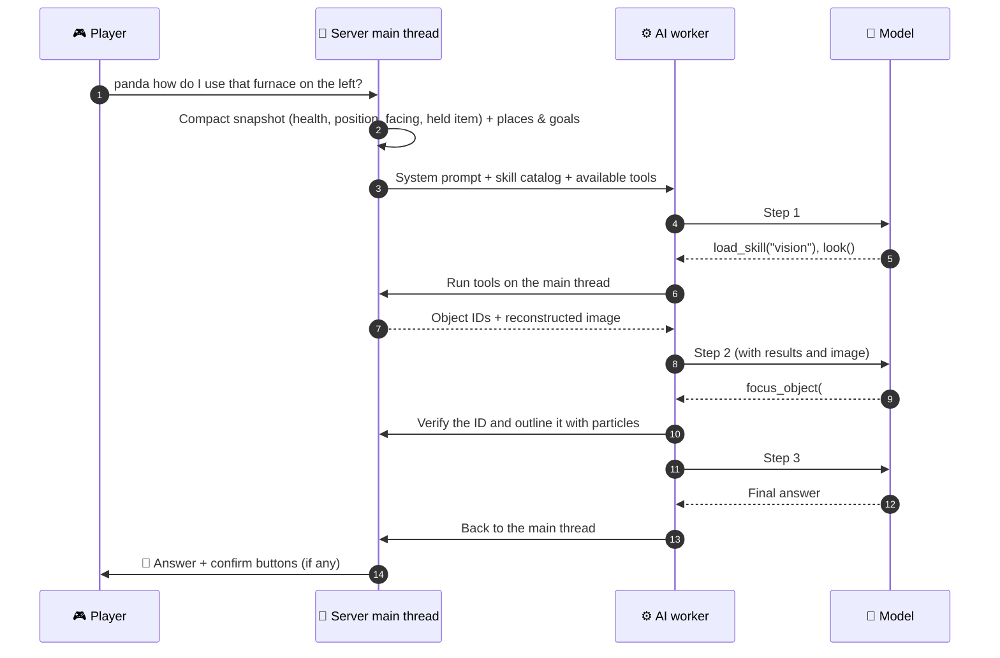

<!-- nav:top -->
<div align="right">

🌐 [简体中文](../zh/Agent-and-Tools.md) · **English** · 📖 [README](../../../README.en.md) · 🏠 [Wiki home](Home.md)

</div>
<!-- /nav:top -->

# 🧠 Agent & Tools

At PandaGPT's core is a **multi-step tool-calling loop**. Every player message is a "turn": within one turn the model may call tools several times, in parallel, look at the results, decide what to do next, and finally answer in a sentence or two.

## Life of a turn



### Key design points

| Design | Detail |
|---|---|
| 🧵 **Tools run on the main thread** | World, inventory and entity reads happen on the server thread; workers only handle immutable text and images |
| ⏳ **Multi-tick tools** | e.g. `look` casts rays over several ticks and the turn waits for it |
| 🔀 **Parallel calls** | The model may request several tools at once; they run in order and return together |
| 💰 **Budgets** | Steps, tool calls, total time and per-result length are capped; when exhausted the model must answer with what it has |
| 🔁 **Safe retries** | Network retries only re-fetch the model reply and never re-run tools |
| 🧹 **Stale results dropped** | After logout, timeout, clear, reload or shutdown, old turns never reach the player |
| 🛡️ **Data is not instructions** | Tool results, server docs and snapshots are explicitly declared as data in the prompt to resist injection |

### Budget settings

```yaml
panda:
  agent:
    max_steps: 8                # model requests per turn
    max_tool_calls: 16          # tool calls per turn
    turn_timeout_seconds: 120   # total time per turn
    max_tool_result_chars: 6000 # truncation length for one tool result
```

## 🛠️ All tools (64)

Tools are grouped by skill. **A tool is offered to the model only if an enabled skill lists it under `tools`**; plugin tools appear only when the plugin is installed.

### Always on

| Tool | Purpose |
|---|---|
| `load_skill` | Read a skill's full instructions (progressive disclosure) |
| `get_player_status` | Full status: inventory summary, armour, offhand, effects, level |
| `set_assistance` | Switch between quiet and assist mode |
| `forget_conversation` | Clear chat history (places and goals stay) |
| `respond_to_pending_action` | Called when the player clearly accepts or declines pending commands |
| `stay_silent` | Proactive turns only: decide to say nothing |

### Places and navigation

| Tool | Purpose |
|---|---|
| `remember_place` | Save a place; `target=looking_at` saves the object under the crosshair |
| `forget_place` · `list_places` | Delete / list places with distances and validity |
| `locate_place` | Direction, distance, height difference and which way to turn |
| `guide_to` · `stop_guidance` | Action-bar arrow plus a private particle trail |
| `map_link` | Clickable web-map link (requires `map_url`) |

### Goals and crafting

| Tool | Purpose |
|---|---|
| `set_goal` · `clear_goal` · `goal_status` | Track "I want item X" or "going mining" with a BossBar |
| `find_recipes` | Real recipes registered on this server, and whether the inventory satisfies them |
| `craftable_now` | What can be crafted right now |

### Environment, vision and survival

| Tool | Purpose |
|---|---|
| `look` | Reconstruct the first-person view (real textures + object IDs + entities + local space) |
| `focus_object` | Verify a numbered region against the live world and outline it with private particles |
| `recall_surroundings` | Latest background observation |
| `nearby_entities` | Nearby mobs, hostile first |
| `world_conditions` | Time, weather, light, biome, difficulty |

### Game memory and distillation

| Tool | Purpose |
|---|---|
| `remember_game_memory` | Persist experiences, facts, plans or lessons preserving the complete current player message |
| `recall_game_memory` | Retrieve relevant evidence with source, world, time and validity |
| `distill_memory` | Background semantic summaries and experience relationships with original evidence references |
| `forget_game_memory` | Preview then delete with a player/revision-bound token and exact player confirmation |

See [Game Memory & Distillation](Game-Memory.md).

### Creative features

| Tool | Purpose |
|---|---|
| `preview_structure` · `clear_preview` | Ghost-block building preview (block / fill / hollow / walls / line / cylinder / sphere / pyramid) |
| `set_reminder` · `list_reminders` · `cancel_reminder` | Real-minute or sunset / nightfall / sunrise reminders |
| `last_death` | Last death's location, cause, drops and time left |
| `player_statistics` | Lifetime stats and this session's change |
| `advancement_progress` | Unfinished advancements, closest first |
| `add_note` · `list_notes` · `remove_note` | To-dos, preferences, memos |
| `inspect_item` | Durability, enchantments, repair cost |
| `villager_trades` | Nearby villager and wandering-trader trades |

### Server

| Tool | Purpose |
|---|---|
| `search_server_knowledge` | Search relevant sections of `knowledge.md` |
| `server_plugins` | Installed plugins, versions and descriptions |
| `list_server_commands` | Plugin commands the player may use |
| `propose_command` | Propose a command run as the player after confirmation; see [Command Proposals](Command-Proposals.md) |

### Plugins (appear when installed)

| Plugin | Tools |
|---|---|
| Vault | `economy_balance` · `economy_can_afford` · `rank_display` |
| PlaceholderAPI | `resolve_placeholders` · `list_placeholder_expansions` |
| LuckPerms | `rank_info` · `rank_tracks` · `check_permission` |
| WorldGuard | `regions_here` |
| GriefPrevention | `claim_here` · `my_claims` |
| Towny | `towny_status` · `towny_plot_here` |
| Lands | `lands_here` · `my_lands` |
| EssentialsX | `essentials_homes` · `essentials_warps` · `essentials_status` |
| CoreProtect | `block_history` |
| mcMMO | `mcmmo_skills` |
| AuraSkills | `auraskills_profile` |

See [Plugin Integrations](Plugin-Integrations.md).

## Context and history

- Each turn carries only a **compact snapshot** (name, health, hunger, game mode, dimension, position, facing, held item) plus places and goals; inventory, mobs, recipes, docs and vision are fetched by tools on demand.
- History is isolated per player UUID and keeps only questions, final answers and tool names; older full rounds are dropped by a character budget (`history_rounds`, `context_char_budget`).
- Images are never kept in history.

<!-- nav:bottom -->
---

<div align="center">

⬅️ [💬 Talking to Panda](Talking-to-Panda.md) &nbsp;·&nbsp; [📚 Contents](Home.md) &nbsp;·&nbsp; [📜 Skills & Prompts](Skills-and-Prompts.md) ➡️

</div>
<!-- /nav:bottom -->
