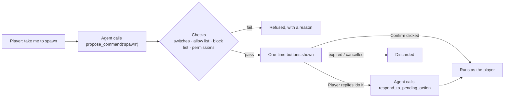

<!-- nav:top -->
<div align="right">

🌐 [简体中文](../zh/Command-Proposals.md) · **English** · 📖 [README](../../../README.en.md) · 🏠 [Wiki home](Home.md)

</div>
<!-- /nav:top -->

# ⚡ Command Proposals

> **A `/command` appearing in any natural-language reply is never executed.**

When a player explicitly asks Panda to do something that needs a command ("take me to spawn"), the agent can only **propose** it through the `propose_command` tool. When the turn ends, the command is shown with confirm / cancel buttons:

```text
[Panda] I can run /spawn to take you back to spawn.
        [✔ Confirm]  [✖ Cancel]
```

## Flow



## Requirements (all of them)

1. `panda.command_awareness.enabled: true`
2. `panda.command_awareness.allow_execution: true` (**off by default**)
3. The command root is in `allowed_commands` and not in `blocked_commands`
4. The player has `pandagpt.use` and `pandagpt.actions`
5. The player clicks Confirm in time, or clearly tells the agent "do it"

```yaml
panda:
  command_awareness:
    enabled: true
    allow_execution: true
    executor: 'player'               # player only; never elevated
    max_executions: 3                # commands per batch
    confirmation_ttl_seconds: 60
    allowed_commands: [help, spawn, home, warp, tpa, balance]
    blocked_commands: [op, deop, stop, restart, reload, execute, sudo, panda, pandaadmin]
```

## Guarantees

| Guarantee | Detail |
|---|---|
| 👤 **Runs as the player** | Never as OP or the console |
| 🔁 **Permissions checked twice** | At proposal and at confirmation; the server dispatches with the player's current permissions |
| 🎟️ **One-time confirmation** | Buttons are single-use server-side click callbacks bound to the player's UUID, with expiry and no replay |
| 🧱 **Syntax limits** | Namespaced commands (`minecraft:xxx`), newlines and chaining are rejected |
| 🚫 **Always blocked** | op, deop, stop, reload, execute, sudo and other admin or wrapper commands |
| 🧮 **Batch limits** | At most `max_executions` per batch; any refusal, failure or permission change stops the batch |
| 🗣️ **Explicit consent only** | The agent may call `respond_to_pending_action` only when the player's next message **clearly agrees**, once per turn; otherwise it must ask |

## Advice for server owners

- The allow list works on **command roots**. Review every sub-command and argument of an allowed command.
- **Do not** allow wrapper commands that can run other commands.
- Bukkit's dispatch result only means the command was accepted, not that the in-game action succeeded; rely on the command's own feedback.
- Want Panda to explain commands but never run them? Keep `allow_execution: false`; the agent can still use `list_server_commands` to tell players what to type.

<!-- nav:bottom -->
---

<div align="center">

⬅️ [🔌 Plugin Integrations](Plugin-Integrations.md) &nbsp;·&nbsp; [📚 Contents](Home.md) &nbsp;·&nbsp; [⚙️ Configuration](Configuration.md) ➡️

</div>
<!-- /nav:bottom -->
