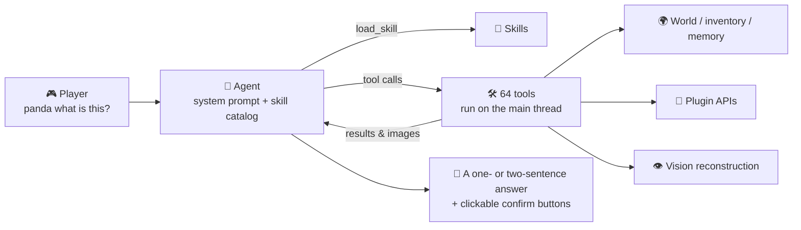

<!-- nav:top -->

🌐 [简体中文](../zh/Home.md) · **English** · 📖 [README](../../../README.en.md)

<!-- /nav:top -->

# 🐼 PandaGPT Wiki

**A zero-command Minecraft AI agent that sees, remembers, looks things up and reminds you. Players just talk.**

Paper 26.3 · Java 25 · 15 model providers · 11 plugin integrations · 35 skills · 12 languages

---

## 🧭 Start here

| I am… | Read |
|---|---|
| 🆕 **A server owner installing it for the first time** | [Installation](Installation.md) → [Model Providers](Model-Providers.md) → [Configuration](Configuration.md) |
| 🎮 **Curious what players can do** | [Talking to Panda](Talking-to-Panda.md) → [Creative Features](Creative-Features.md) |
| 🧠 **Customising the agent** | [Agent & Tools](Agent-and-Tools.md) → [Skills & Prompts](Skills-and-Prompts.md) |
| 🔌 **Running lots of plugins** | [Plugin Integrations](Plugin-Integrations.md) |
| 🛡️ **Focused on safety, privacy and performance** | [Command Proposals](Command-Proposals.md) · [Privacy & Security](Privacy-and-Security.md) · [Performance](Performance.md) |
| 🛠️ **Contributing code** | [Development](Development.md) |

## 📚 All pages

### Getting started
- 📦 [Installation & Upgrading](Installation.md): drop in the JAR, add a key, official textures download themselves
- 🤖 [Model Providers](Model-Providers.md): OpenAI, Gemini, Claude, DeepSeek, Qwen, Kimi, GLM, Doubao and more (15 in total)
- 💬 [Talking to Panda](Talking-to-Panda.md): how the zero-command interface works, with lots of examples

### How it works
- 🧠 [Agent & Tools](Agent-and-Tools.md): the multi-step tool loop and all 64 tools
- 🧠 [Game Memory & Distillation](Game-Memory.md): recover the right event, fact, plan or lesson when needed
- 📜 [Skills & Prompts](Skills-and-Prompts.md): progressively disclosed skills and how to write your own
- 🔔 [Proactive Assistant](Proactive-Assistant.md): when Panda speaks up unprompted, and why it usually stays quiet
- 👁️ [Vision & Perception](Vision-and-Perception.md): raycast first-person reconstruction, object IDs, space and entity observation, place memory

### Gameplay & ecosystem
- ✨ [Creative Features](Creative-Features.md): ghost-block building previews, particle guidance, reminders, death recall, notes and more
- 🔌 [Plugin Integrations](Plugin-Integrations.md): Vault, PlaceholderAPI, LuckPerms, WorldGuard, Towny and more
- ⚡ [Command Proposals](Command-Proposals.md): how the agent runs commands only after the player confirms

### Operations

- 📝 [Changelog](../../../CHANGELOG.en.md): features, configuration changes and upgrade notes
- ⚙️ [Configuration](Configuration.md): every `config.yml` option explained
- 🌍 [Languages](Languages.md): 12 built-in languages and custom translations
- 🔑 [Permissions & Admin](Permissions-and-Admin.md)
- 🚀 [Performance](Performance.md): per-tick budgets, load shedding and tuning
- 🛡️ [Privacy & Security](Privacy-and-Security.md)
- ❓ [FAQ](FAQ.md)
- 🛠️ [Development](Development.md)

## 🏗️ The big picture

<!-- nav:bottom -->
---

[📚 Contents](Home.md) &nbsp;·&nbsp; [📦 Installation](Installation.md) ➡️

<!-- /nav:bottom -->
