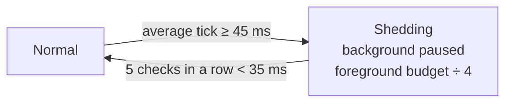

<!-- nav:top -->
<div align="right">

🌐 [简体中文](../zh/Performance.md) · **English** · 📖 [README](../../../README.en.md) · 🏠 [Wiki home](Home.md)

</div>
<!-- /nav:top -->

# 🚀 Performance

Goal: **world sampling work is always bounded, and backs off when the server is busy.** Model requests run on separate worker threads and never occupy the main thread.

## Per-tick budget

Vision rays, local-space surveys, particle re-checks and background checks **share** one budget that does not multiply with player count:

| Budget | Default | Notes |
|---|---|---|
| Time | 2 ms | Soft budget, checked before every cell |
| Ray / survey / marker units | 256 | Server-wide |
| DDA or survey cells | 8192 | Long rays pause mid-way and resume next tick when exhausted |

Players rotate in slices of at most 32 cells; blocks, surface properties and chunk accessibility are cached within a tick and cleared on the next. Only chunks already sent to the player and still loaded are read; **chunk loads are never triggered**.

## Load shedding



- Average tick time is checked every 20 ticks; thresholds assume 20 TPS.
- Manual captures can reclaim slots used by background work.
- Background rotation checks one player every 5 ticks (at most 4 per second).

## Other bounded resources

| Resource | Bound |
|---|---|
| AI workers / queue | 4 / 32; rejected when full, without collecting context |
| Runtime plan / pending check | One objective, up to 8 steps and one pending check per session, bounded by `panda.max_sessions` |
| Proactive turns | One background turn per player; shares conversation workers/queue and yields to that player's new question |
| Model-scheduled checks | Default 3 turns per request, minimum delay 60 seconds; normal step/tool/deadline limits still apply |
| Log queue | 256 entries; extra entries are dropped and counted |
| Place memory I/O | Separate bounded queue; repeated saves per player are merged |
| Texture cache | 64 MiB decoded pixels + 4096 states + 8192 coordinate variants, LRU |
| Render queue | Single thread, bounded |

The runtime rotates one pending player check per five eligible ticks, only when background work and the shared budget permit it. More players or high load can delay checks; they are not punctual timers. Undue or unmatched checks do not call the model. Triggered model waits obey the shared turn deadline and receive cancellation.

## Monitoring

`/pandaadmin status` shows the last 512 ticks' p95, cumulative max, cells visited, block reads, cache hits, shedding ticks, render queue and dropped logs. `runtime`, `follow_ups` and `proactive_active` report runtime configuration, pending-check count and background turns, rather than player plan contents. For whole-server profiling use [spark](https://spark.lucko.me/).

## Conservative settings

For weaker hardware or busy servers, start with:

```yaml
panda:
  perception:
    observe_seconds: 60
    entity_radius: 12
    max_entities: 8
  vision:
    width: 96
    height: 54
    max_distance: 48
    rays_per_tick: 128
    cells_per_tick: 4096
    time_budget_ms: 1
    max_concurrent_captures: 1
    max_debug_particles: 12
    save_images: false
```

Lower size, distance and budgets together. Shrinking only the budget while keeping large images and long distances may hit the 200-tick timeout often.

## Limits

This is not a hard real-time guarantee: a single native API call (such as an entity spatial query) cannot be interrupted mid-way, and GC or other plugins can still cause lag. Near dense mob farms, lower `entity_radius` or disable background perception.

Full methodology and baseline comparison: [docs/performance.md](../../performance.md) (Chinese).

<!-- nav:bottom -->
---

<div align="center">

⬅️ [🔑 Permissions & Admin](Permissions-and-Admin.md) &nbsp;·&nbsp; [📚 Contents](Home.md) &nbsp;·&nbsp; [🛡️ Privacy & Security](Privacy-and-Security.md) ➡️

</div>
<!-- /nav:bottom -->
