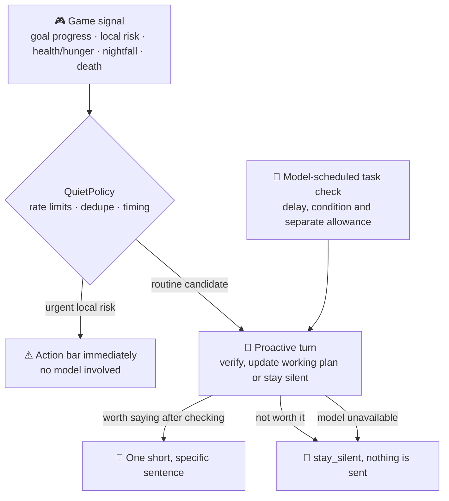

<!-- nav:top -->

🌐 [简体中文](../zh/Proactive-Assistant.md) · **English** · 📖 [README](../../../README.en.md) · 🏠 [Wiki home](Home.md)

<!-- /nav:top -->

# 🔔 Proactive Assistant

> A good assistant is quiet most of the time. Panda only speaks up when it is **genuinely useful**, and every time the agent checks the facts before deciding to say anything.

## How it works

## Signals that start a proactive turn

| Signal | When | Panda might say |
|---|---|---|
| ✅ Goal materials ready | Everything for your goal item is in your inventory | "You have everything for the iron pickaxe, and there's a crafting table right here." |
| 🛠️ Craft on the way | Materials ready and a crafting table observed nearby | Same, pointing at the table |
| ⛏️ Departure check | Leaving home (8 blocks) with a mining goal | "Only 3 torches left; top up first?" |
| ❤️ Low health / hunger | Persistently low values | "You're nearly starving; there's bread in your bag." |
| 🌙 Nightfall far from home | It's getting dark and you're far away | "It's dark; home is 230 blocks north-east." |
| 💀 Just died | After a death | "You died near the mine entrance; your items vanish in about 5 minutes. Want me to guide you?" |
| ⚠️ Local risk | Drops or lava ahead | Shown in the action bar directly, no model |

## Constraints on proactive turns

- **Game data stays read-only**, e.g. `goal_status`, `locate_place`, `nearby_entities`, `last_death`, `economy_balance`, `regions_here`, plus temporary planning, bounded checks and `stay_silent`.
- **Cannot** propose commands, change gameplay goals, set game reminders or change gameplay state; working-plan updates only affect the assistant's temporary state.
- One sentence of about 40 characters (Chinese) or a short line, saying what was found and what to do. No small talk, no questions.
- The model makes the final routine-message decision. Unavailable models or disabled proactive turns stay silent; candidate text is never sent as a fallback.

## Model-scheduled task checks

Beyond game events, the model may maintain a plan for an actual multi-step player request and choose rechecks by time or changed observations. A check includes recent conversation, the original request, task state and fresh observations. The model verifies progress and decides whether to wait, adapt the plan, speak or stay silent. Simple questions should not create ongoing tasks.

Defaults are a minimum 60-second delay and 3 automatic follow-up turns per request, separate from the game-event rate limits below. Unchanged snapshots do not trigger `state_change`. A timer triggers one evaluation; another requires an explicit model schedule and remaining allowance. Each follow-up turn may make multiple model calls within `panda.agent.max_steps`. A check expires 30 minutes beyond its due time. New questions, quiet mode, logout, cleared sessions and reloads cancel background work.

Working plans do not survive restart and authorize neither command execution nor persistent-memory mutations. See the [agent runtime](Agent-Runtime.md). Geometry observation still uses no model; event evaluations and scheduled checks add model requests and cost.

## Frequency and interruptions

| Rule | Default |
|---|---|
| Minimum gap between routine event evaluations | 15 minutes (`perception.suggestion_seconds: 900`) |
| Event evaluations per rolling half hour | 2 (`perception.routine_per_half_hour: 2`; 0 disables) |
| Same fact | Deduplicated, never repeated |
| Pending queue | Keeps only the single most valuable tip; dropped if no good moment within 20 seconds |
| After combat, placing/breaking or interacting | Routine tips wait 5 seconds |
| Conditions no longer true | Missing materials again, goal cancelled, moved away, logged out, etc. withdraw the tip |

Urgent local risks use separate short-term deduplication and don't count toward the routine limit.

## Switches

| Goal | How |
|---|---|
| Player opts out | Tell Panda "don't disturb me"; "you can remind me again" to resume |
| Disable AI proactive messages and task checks | `panda.agent.proactive: false` |
| Disable proactive tips entirely | `panda.perception.proactive: false` |
| Disable perception, goals and memory | `panda.perception.enabled: false` |

Quiet mode also hides the goal bar, but players can still ask anything at any time.

## Background observation

In assist mode the plugin schedules at most one low-resolution **32×18** geometry observation within 24 blocks every 30 seconds, for later `recall_surroundings`. Background observation:

- reads no textures and writes no PNGs;
- **never calls the model and costs nothing**;
- requires `pandagpt.vision` (OP only by default), so regular players are not observed just because the plugin was upgraded;
- pauses automatically under load; see [Performance](Performance.md).

<!-- nav:bottom -->
---

⬅️ [📜 Skills & Prompts](Skills-and-Prompts.md) &nbsp;·&nbsp; [📚 Contents](Home.md) &nbsp;·&nbsp; [👁️ Vision & Perception](Vision-and-Perception.md) ➡️

<!-- /nav:bottom -->
