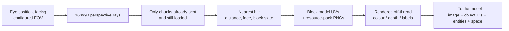
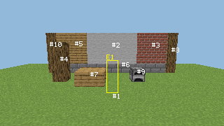

<!-- nav:top -->
<div align="right">

🌐 [简体中文](../zh/Vision-and-Perception.md) · **English** · 📖 [README](../../../README.en.md) · 🏠 [Wiki home](Home.md)

</div>
<!-- /nav:top -->

# 👁️ Vision & Perception

Without any client mod, PandaGPT **reconstructs the player's first-person view on the server**: it raycasts blocks pixel by pixel, shades them with vanilla resource-pack models and textures, and hands the image to a vision-capable model.


## 🎯 `look`: reconstructing the view



| Output | Content |
|---|---|
| `color.png` | Real textures, model UVs, approximate biome tint and face lighting |
| `depth.png` | Ray distance in greyscale: near is bright |
| `labels.png` | Material category colours |
| `metadata.json` | Camera, per-pixel distance and object IDs, validity masks, entity and local-space results |

With `save_images` on, only the latest set per player is kept in `captures/<UUID>/`, never served over HTTP.

**Rendering details**: blockstate variants / multipart, model parents and texture references; face UV rotation, model rotation and uvlock; stairs, slabs, log axes and furnace facing use their own models; grass and leaves read colour maps; animated textures use the first frame. Missing models show a magenta checkerboard, grey checkerboard marks inaccessible data, and blue means no hit within range (not proof of sky).

### Official textures

On start the plugin **downloads and verifies vanilla textures from Mojang automatically**; see [Installation](Installation.md#textures). You can layer a server resource pack on top:

```yaml
panda:
  vision:
    textures:
      enabled: true
      auto_download: true
      packs:
        - 'assets/vanilla-26.3.zip'   # downloaded automatically
        - 'assets/server-pack.zip'    # your own, overrides earlier packs
      cache_mib: 64
```

## 🔢 Object IDs and `focus_object`

Each capture merges adjacent, connected surfaces of the same kind into **regions** and numbers them (up to 48); interactive blocks such as furnaces and crafting tables keep separate IDs. The image is overlaid with `#ID` labels.

When a player says "that furnace on the left", the agent:

1. calls `look` to get IDs;
2. calls `focus_object(#3)`. The server checks the ID, observation age, the player's world, facing and permission, and the target block's **current** state. **Coordinates invented by the model are never accepted**;
3. outlines the object with up to 12 occlusion-checked points as particles only that player sees (requires `pandagpt.vision.debug`).

## 🧱 Local space survey

Copies the real collision boxes of the **7×7×7** cells around the player and reports, for 1–3 blocks ahead in left/centre/right columns: headroom, footing, drop height, hazards or unknowns.

- `PASSABLE_LOCAL` only proves a 0.6×1.8 standing space with support in that column, not that a whole route is reachable.
- Building analysis gives "opening candidates" and local air connectivity, which do not prove a building is sealed or airtight.

## 🐺 Entity observation

UUID, type, position, bounding box, item counts and a mob's current target are copied on the main thread, only within a limited radius, in sent and loaded chunks, honouring `player.canSee`. The same camera projection with 3×3 rays per box is compared against block depth, giving `VISIBLE_SAMPLES`, `OCCLUDED_SAMPLES`, `OUTSIDE_FOV` or `UNKNOWN_SAMPLES`. Visible entities get a yellow `E<ID>` box (entity textures are not rendered).



## ⏱️ Continuous observation and invalidation

- Short-term comparison uses world + block coordinates, so turning your head never reports blocks as "gone".
- Entities are compared by UUID with radial motion from one eye position, so walking forward isn't mistaken for a mob approaching.
- Placing, breaking, interaction, redstone, fluids, fire, explosions or pistons at known coordinates invalidate related observations and memories immediately.
- A running capture is cancelled only when an already-hit block or copied cell changes; nearby flowing water, furnaces or redstone won't keep failing it.

## 📍 Place memory

- Saved per player UUID in `memory/<UUID>.json`: world, coordinates, block state, source, recorded and last-verified times, plus goals and notes.
- Up to 32 places per player; auto-recorded interactive blocks are evicted first, places you named are kept.
- Sleeping in a bed or using a respawn anchor saves "home" automatically; a home you named takes priority.
- Loads and saves go through a separate bounded I/O queue with atomic replacement; the main thread never touches disk, and corrupt files are never overwritten.
- Other players' inventories and chests are never read, and no full world map is stored.

## 🎯 Goals

Goals are only set when you clearly state what you want, e.g. "I want an iron pickaxe". Item goals use real recipes and your inventory, show progress on one BossBar, and complete with a brief ✓ once you hold the item. Mining goals report torches, pickaxes and food and check them as you leave home.

## ⚙️ Parameters

| Setting | Default | Notes |
|---|---|---|
| `vision.width` × `height` | 160×90 | One ray per pixel |
| `vision.vertical_fov` | 70 | The server can't read the client's real FOV |
| `vision.max_distance` | 96 | Also limited by view distance and loaded chunks |
| `vision.max_concurrent_captures` | 2 | Simultaneous captures |
| `vision.timeout_ticks` | 200 | Cancel after this |
| `vision.cooldown_seconds` | 10 | Per-player cooldown |
| `perception.observe_seconds` | 30 | Background observation interval |
| `perception.scene_ttl_seconds` | 60 | Observation lifetime |

Scheduling budgets (2 ms, 256 rays, 8192 cells per tick) are covered in [Performance](Performance.md).

## 🚧 Limits

This reconstructs server-side block collision and resource-pack textures. **It is not a client screenshot**: no entity models, special renderers such as chests, shaders, HUD or held items; glass and water detect only the first layer; OptiFine / CTM are unsupported. The server also can't know the client's real FOV, aspect ratio or client-side fake blocks.

<!-- nav:bottom -->
---

<div align="center">

⬅️ [🔔 Proactive Assistant](Proactive-Assistant.md) &nbsp;·&nbsp; [📚 Contents](Home.md) &nbsp;·&nbsp; [✨ Creative Features](Creative-Features.md) ➡️

</div>
<!-- /nav:bottom -->
