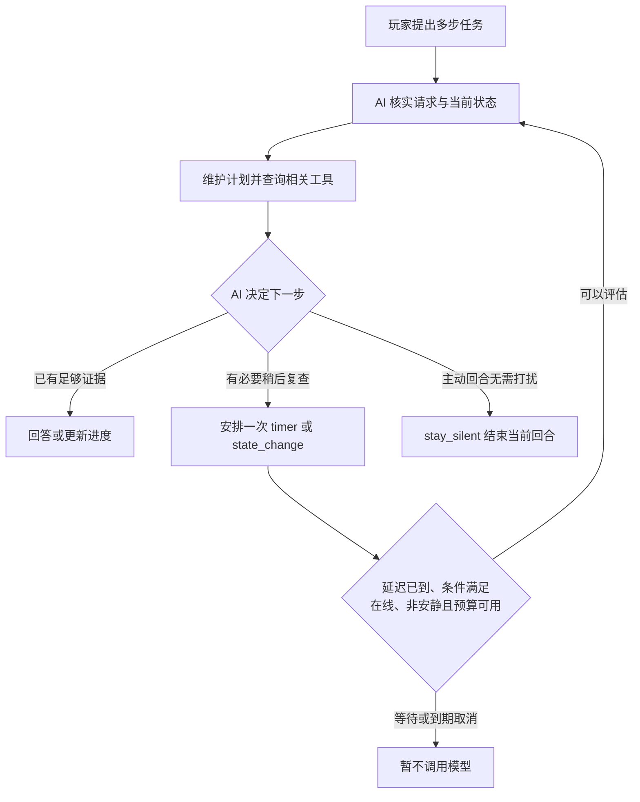

<!-- nav:top -->
<div align="right">

🌐 **简体中文** · [English](../en/Agent-Runtime.md) · 📖 [README](../../../README.md) · 🏠 [Wiki 首页](Home.md)

</div>
<!-- /nav:top -->

# 🧭 智能体运行时

运行时让 Panda 能围绕玩家实际提出的多步任务维护计划，根据新证据调整步骤，并决定是否稍后复查、提醒或保持安静。AI 负责选择目标、步骤、查询工具与下一次复查；插件负责执行边界、预算、权限和取消。

简单问题仍可直接回答，不要求建立计划。运行时不会自行执行游戏命令，计划中的“完成”也不能代替工具或游戏世界给出的证据。

## 玩家可以怎样使用

```text
<Steve> panda 帮我准备去下界，先检查装备和补给，有需要再跟进
[Panda] 我先检查装备、食物和抗火准备，再根据缺口给你建议。

……玩家继续游戏，AI 已安排的复查到期且条件满足……
[Panda] 食物已经备齐，出发前再检查抗火和返程准备。

<Steve> panda 先别管下界，帮我看看眼前这个方块
[Panda] 好，我先看你眼前的方块。

<Steve> panda 别打扰我
[Panda] 已切换为安静模式。
```

这是交互示意，不代表固定台词或每次都会跟进。AI 必须查询真实数据；证据不足或没有有用进展时可以不发消息。同一玩家的新提问会取消旧的后台回合和待复查项，旧计划仍可供新回合理解上下文。

## 从请求到再次判断



运行时只保存简短的工作状态：原始玩家请求、一个当前目标、1–8 个步骤、步骤进度、AI 对活动的解释及剩余复查预算。它不保存模型的隐藏推理。

| 任务阶段 | 含义 |
|---|---|
| `idle` | 尚未建立任务 |
| `active` | 已有计划，未安排下一次复查 |
| `waiting` | 已安排一项待复查 |
| `blocked` | 有受阻步骤，且当前没有进行中的步骤 |
| `completed` | 所有步骤已被标记完成，不能直接安排复查 |

活动解释与步骤进度属于 AI 的可修正判断，不是新的长期记忆证据。切换阶段本身不创建物品、不传送，也不改变服务器玩法状态。

## 复查的两种条件

| 条件 | 触发方式 | 适合的情况 |
|---|---|---|
| `timer` | 最小延迟到达后，等待可用时机进行一次评估 | 稍后重新核实准备进度 |
| `state_change` | 最小延迟到达后，当前事实快照与安排时不同 | 等玩家移动、补给或已有目标进度发生变化 |

变化检测只比较精简快照、16 格位置分区、世界及感知模块已有的目标和活动信息；转动视角不会单独触发复查。它不监听每个背包槽位或全部插件事件。装备、交易、职业和任务等详细信息仍需 AI 调用对应工具核实。

每项复查都是一次性安排；需要继续等待时，AI 必须再次明确安排并且仍有预算。更新计划会取消旧的待复查。`stay_silent` 立即结束当前回合；此前明确安排且仍有效的复查可以保留。

复查不是准点提醒：服务器负载、玩家轮转、战斗或建造、待确认命令、前台提问和模型队列都可能推迟它。到期后再过 30 分钟仍未触发时会丢弃；会话也可能更早过期或被容量淘汰。需要“十分钟后叫我”这样的提醒时，使用[提醒功能](Creative-Features.md#-提醒)。

## 配置与费用

```yaml
panda:
  agent:
    proactive: true
    runtime:
      enabled: true
      follow_up_min_seconds: 60
      max_follow_ups: 3
```

| 配置 | 默认 | 含义 |
|---|---|---|
| `panda.agent.runtime.enabled` | `true` | 启用临时计划、运行时提示词与三个运行时工具；同时需要核心 `panda` 技能 |
| `panda.agent.runtime.follow_up_min_seconds` | 60 | AI 安排复查的最小延迟，范围 30–1800 秒；单次延迟最多 1800 秒 |
| `panda.agent.runtime.max_follow_ups` | 3 | 当前玩家请求最多自动复查回合数，范围 0–6；主动回合不能自行补充 |
| `panda.agent.proactive` | `true` | 允许普通 AI 主动回合；关闭后不发送预设文案代替 AI |

完整配置见[配置参考](Configuration.md#agent)。

**3 次复查指 3 个回合，不是最多 3 次模型请求。** 每个回合仍受 `panda.agent.max_steps` 约束，默认最多 8 个模型生成步骤；网络重试和记忆语义蒸馏有各自的规则。事件触发的普通评估另受 `panda.perception.suggestion_seconds` 与 `routine_per_half_hour` 控制。将后者设为 0 不会单独关闭 AI 安排的任务复查。

没有安排复查，或 `state_change` 条件未命中时，本地检查不会调用模型。触发后的评估、工具结果与上下文会发送给所配置的模型服务商，并产生相应请求和费用。

| 希望保留什么 | 设置方式 |
|---|---|
| 保留对话计划，关闭自动任务复查 | `panda.agent.runtime.max_follow_ups: 0` |
| 关闭运行时，保留普通事件触发的 AI 建议 | `panda.agent.runtime.enabled: false`，保持 `panda.agent.proactive: true` |
| 保留对话计划，关闭普通 AI 主动消息与任务复查 | `panda.agent.proactive: false` |
| 关闭全部感知主动提示，包括即时局部风险 | `panda.perception.proactive: false` |

玩家可说“别打扰我”进入安静模式，仍可主动提问。即时坠落、岩浆风险使用本地动作栏提示，不等待 AI；它们不受 `panda.agent.proactive` 单独控制。

## 临时计划、记忆与授权

临时计划按玩家 UUID 隔离，随会话清除、过期、容量淘汰或重启释放；重载不会恢复计划。默认会话空闲期限为 1800 秒，见 `panda.session_ttl_seconds`。运行时计划不会写入 `memory/<UUID>.json`；需要长期保存的经历、偏好、计划或经验仍使用[游戏记忆](Game-Memory.md)。

主动回合可以读取已启用技能中的独立只读工具、更新既有目标的计划、安排有预算的复查或保持安静。它不能创建新的玩家目标、执行命令、设置游戏提醒、写入或删除长期记忆。命令执行和遗忘继续遵守各自的玩家确认流程。

运行时数据、近期对话和相关记忆可进入模型上下文。`prompts/runtime.md` 会追加到对话与主动回合，已有自定义 `system.md` 和 `proactive.md` 不会被覆盖；服务重载后生效。详情见[技能与提示词](Skills-and-Prompts.md)及[安全与隐私](Privacy-and-Security.md)。

## 检查为什么没有继续跟进

1. 执行 `/pandaadmin status`，核对 `configured`、`runtime`、`follow_ups`、`proactive_active` 和队列。它们是服务状态，不是某位玩家的完整计划。
2. 检查 AI 是否实际调用了 `schedule_follow_up`；仅创建计划不代表已安排复查，`follow_ups` 为 0 也可能表示检查已开始或已结束。
3. 检查核心 `panda` 技能、运行时和主动功能开关、玩家权限与安静模式；未加载的辅助状态不会开始主动复查。
4. 对 `state_change`，确认最小延迟已到，且当前快照与安排时不同；背包某个未被快照覆盖的槽位变化不一定触发。
5. 检查复查预算、会话是否被清除、重载、过期或淘汰，以及玩家是否提出了新问题。
6. AI 可以决定安静；模型失败、条件失效或发送前状态变化也会使结果丢弃。没有消息不一定代表故障。

<!-- nav:bottom -->
---

<div align="center">

⬅️ [🧠 Agent 与工具](Agent-and-Tools.md) &nbsp;·&nbsp; [📚 目录](Home.md) &nbsp;·&nbsp; [🧠 游戏记忆](Game-Memory.md) ➡️

</div>
<!-- /nav:bottom -->
