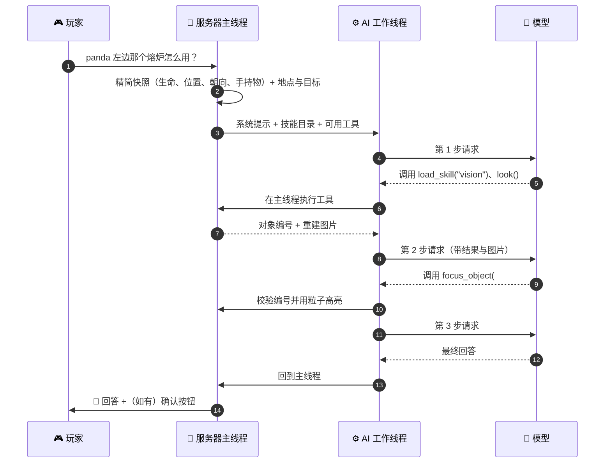

<!-- nav:top -->
<div align="right">

🌐 **简体中文** · [English](../en/Agent-and-Tools.md) · 📖 [README](../../../README.md) · 🏠 [Wiki 首页](Home.md)

</div>
<!-- /nav:top -->

# 🧠 Agent 与工具

PandaGPT 的核心是一个**多步工具调用循环**。玩家的每句话是一个“回合”：模型可以在一个回合内多次、并行地调用工具，看到结果后再决定下一步，最后用一两句话回答。

## 一个回合的生命周期



### 关键设计

| 设计 | 说明 |
|---|---|
| 🧵 **工具都在主线程执行** | 读取世界、背包、实体都在服务器主线程完成；工作线程只处理不可变的文本与图片 |
| ⏳ **支持跨 tick 的工具** | 例如 `look` 需要分多个 tick 发射射线，回合会等待它完成 |
| 🔀 **并行调用** | 模型一次可以请求多个工具，插件逐个执行后一起返回 |
| 💰 **预算上限** | 步数、工具调用数、总时长、单个结果长度都有上限；预算用尽时要求模型立即用已有信息作答 |
| 🔁 **安全重试** | 网络重试只会重新获取模型回复，不会重复执行工具 |
| 🧹 **过时结果丢弃** | 玩家离线、超时、清除对话、重载或停服时，旧回合的结果不会再发给玩家 |
| 🛡️ **数据不是指令** | 工具结果、服务器资料与快照在提示词中被明确声明为数据，防止注入 |

### 预算配置

```yaml
panda:
  agent:
    max_steps: 8                # 每回合最多请求模型几次
    max_tool_calls: 16          # 每回合最多执行几个工具
    turn_timeout_seconds: 120   # 每回合总时长
    max_tool_result_chars: 6000 # 单个工具结果交给模型前的截断长度
```

## 🛠️ 工具一览（64 个）

工具按技能分组。**一个工具只有在某个已启用技能的 `tools` 中列出时才会提供给模型**；外部插件的工具只在安装了对应插件时出现。

### 常驻

| 工具 | 作用 |
|---|---|
| `load_skill` | 读取某个技能的完整说明（渐进式披露） |
| `get_player_status` | 完整状态：背包摘要、护甲、副手、药水效果、等级 |
| `set_assistance` | 切换安静模式 / 主动辅助 |
| `forget_conversation` | 清空对话历史（地点、目标保留） |
| `respond_to_pending_action` | 玩家明确同意或拒绝待确认的命令时调用 |
| `stay_silent` | 仅主动回合：决定此刻不说话 |

### 地点与导航

| 工具 | 作用 |
|---|---|
| `remember_place` | 记住地点；`target=looking_at` 会记下准星对准的对象 |
| `forget_place` · `list_places` | 删除 / 列出地点（含距离与是否仍有效） |
| `locate_place` | 方向、距离、高度差，以及该往哪边转 |
| `guide_to` · `stop_guidance` | 动作栏箭头 + 私有粒子路线导航 |
| `map_link` | 可点击的网页地图链接（需配置 `map_url`） |

### 目标与合成

| 工具 | 作用 |
|---|---|
| `set_goal` · `clear_goal` · `goal_status` | 跟踪“我想要某物品”或“去挖矿”，用 BossBar 显示进度 |
| `find_recipes` | 本服真实注册的配方，以及背包是否满足 |
| `craftable_now` | 现在就能合成的物品 |

### 环境、视觉与生存

| 工具 | 作用 |
|---|---|
| `look` | 重建玩家眼前的第一人称画面（真实纹理 + 对象编号 + 实体 + 局部空间） |
| `focus_object` | 对照实时世界核对某个编号，并用私有粒子勾出轮廓 |
| `recall_surroundings` | 最近一次后台观察 |
| `nearby_entities` | 附近生物，怪物优先 |
| `world_conditions` | 时间、天气、光照、生物群系、难度 |

### 游戏记忆与记忆蒸馏

| 工具 | 用途 |
|---|---|
| `remember_game_memory` | 保存玩家明确表达的经历、事实、计划或经验，正文必须引用本次原话 |
| `recall_game_memory` | 按需求检索原始证据，标明来源、世界、时间与有效性 |
| `distill_memory` | 独立处理事件、事实、计划、经验，保留证据引用 |
| `forget_game_memory` | 删除记忆、关联原始记录与同主题旧版本 |

详见[游戏记忆与记忆蒸馏](Game-Memory.md)。

### 创意功能

| 工具 | 作用 |
|---|---|
| `preview_structure` · `clear_preview` | 幽灵方块建筑预览（方块 / 实心 / 空心 / 墙 / 线 / 圆柱 / 球 / 金字塔） |
| `set_reminder` · `list_reminders` · `cancel_reminder` | 现实分钟数或日落 / 入夜 / 日出提醒 |
| `last_death` | 最近一次死亡的位置、原因、掉落物与剩余时间 |
| `player_statistics` | 生涯统计与本次上线的变化 |
| `advancement_progress` | 未完成成就，按接近程度排序 |
| `add_note` · `list_notes` · `remove_note` | 待办、偏好、备忘 |
| `inspect_item` | 耐久、附魔、修复费用 |
| `villager_trades` | 附近村民与流浪商人的交易 |

### 服务器

| 工具 | 作用 |
|---|---|
| `search_server_knowledge` | 检索 `knowledge.md` 中的相关段落 |
| `server_plugins` | 已安装的插件、版本与简介 |
| `list_server_commands` | 玩家有权限使用的插件命令 |
| `propose_command` | 提出由玩家本人执行、需确认的命令，见 [命令提案](Command-Proposals.md) |

### 外部插件（安装后自动出现）

| 插件 | 工具 |
|---|---|
| Vault | `economy_balance` · `economy_can_afford` · `rank_display` |
| PlaceholderAPI | `resolve_placeholders` · `list_placeholder_expansions` |
| LuckPerms | `rank_info` · `rank_tracks` · `check_permission` |
| WorldGuard | `regions_here` |
| GriefPrevention | `claim_here` · `my_claims` |
| Towny | `towny_status` · `towny_plot_here` |
| Lands | `lands_here` · `my_lands` |
| EssentialsX | `essentials_homes` · `essentials_warps` · `essentials_status` |
| CoreProtect | `block_history` |
| mcMMO | `mcmmo_skills` |
| AuraSkills | `auraskills_profile` |

详见 [插件集成](Plugin-Integrations.md)。

## 上下文与历史

- 每个回合只附带**精简快照**（名字、生命、饥饿、模式、维度、位置、朝向、手持物品）以及地点记忆与目标；背包、生物、配方、资料、视觉都由 Agent 按需调用工具获取。
- 历史按玩家 UUID 隔离，只保留问题、最终回答与用过的工具名；按字符预算淘汰较旧的完整轮次（`history_rounds`、`context_char_budget`）。
- 图片不会保留在历史中。

<!-- nav:bottom -->
---

<div align="center">

⬅️ [💬 和 Panda 对话](Talking-to-Panda.md) &nbsp;·&nbsp; [📚 目录](Home.md) &nbsp;·&nbsp; [📜 技能与提示词](Skills-and-Prompts.md) ➡️

</div>
<!-- /nav:bottom -->
