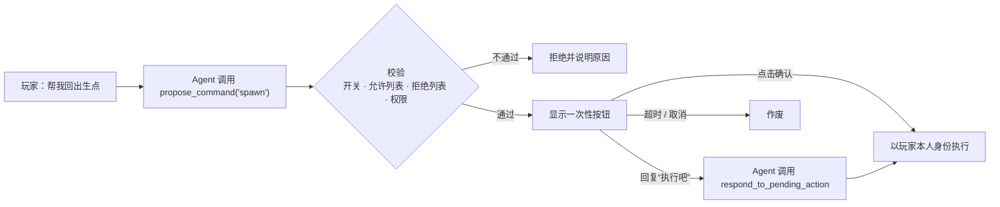

<!-- nav:top -->
<div align="right">

🌐 **简体中文** · [English](../en/Command-Proposals.md) · 📖 [README](../../../README.md) · 🏠 [Wiki 首页](Home.md)

</div>
<!-- /nav:top -->

# ⚡ 命令提案

> **任何自然语言回复中的 `/命令` 都不会被自动执行。**

当玩家明确要求 Panda 做某件需要命令的事（例如“帮我回出生点”），Agent 只能通过 `propose_command` 工具**提出**命令。回合结束后，命令连同确认 / 取消按钮一起显示给玩家：

```text
[Panda] 我可以帮你执行 /spawn 回到出生点。
        [✔ 确认]  [✖ 取消]
```

## 流程



## 启用条件（全部满足）

1. `panda.command_awareness.enabled: true`
2. `panda.command_awareness.allow_execution: true`（**默认关闭**）
3. 命令根名称在 `allowed_commands` 中，且不在 `blocked_commands` 中
4. 玩家拥有 `pandagpt.use` 与 `pandagpt.actions`
5. 玩家在有效期内点击确认按钮，或明确告诉 Agent “执行吧”

```yaml
panda:
  command_awareness:
    enabled: true
    allow_execution: true
    executor: 'player'               # 只支持 player，绝不提升权限
    max_executions: 3                # 每批最多几条
    confirmation_ttl_seconds: 60
    allowed_commands: [help, spawn, home, warp, tpa, balance]
    blocked_commands: [op, deop, stop, restart, reload, execute, sudo, panda, pandaadmin]
```

## 安全保证

| 保证 | 说明 |
|---|---|
| 👤 **玩家身份执行** | 执行者只能是玩家本人，绝不使用 OP 或控制台代执行 |
| 🔁 **权限双重检查** | 提案时与确认时都会重新检查权限；最终由服务器按玩家现有权限派发 |
| 🎟️ **一次性确认** | 按钮是服务器端的一次性点击回调，与玩家 UUID 绑定、有过期时间、不能重放 |
| 🧱 **语法限制** | 拒绝命名空间命令（`minecraft:xxx`）、换行与命令串联 |
| 🚫 **永久拒绝** | op、deop、stop、reload、execute、sudo 等管理或包装类命令始终被拒绝 |
| 🧮 **数量上限** | 每批最多 `max_executions` 条；任何一条被拒绝、失败或权限变化都会停止 |
| 🗣️ **自然语言同意须明确** | Agent 只有在玩家下一句话**清楚表示同意**时才能调用 `respond_to_pending_action`，每回合最多一次；不确定时必须先问 |

## 给服主的建议

- 允许列表的粒度是**命令根名称**。请审核该命令全部子命令与参数的权限语义。
- **不要**加入可以间接执行其他命令的包装插件命令。
- Bukkit 的派发返回值只表示命令被接受，不代表具体游戏动作一定成功，请以命令自身的反馈为准。
- 只想让 Panda 介绍命令、不想执行？保持 `allow_execution: false`，Agent 仍可通过 `list_server_commands` 告诉玩家该用什么命令。

<!-- nav:bottom -->
---

<div align="center">

⬅️ [🔌 插件集成](Plugin-Integrations.md) &nbsp;·&nbsp; [📚 目录](Home.md) &nbsp;·&nbsp; [⚙️ 配置参考](Configuration.md) ➡️

</div>
<!-- /nav:bottom -->
