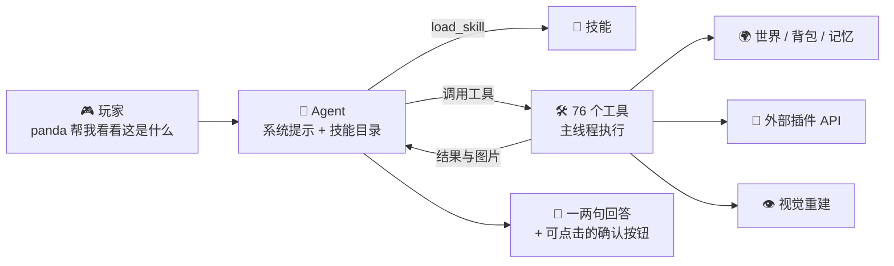

<!-- nav:top -->

🌐 **简体中文** · [English](../en/Home.md) · 📖 [README](../../../README.md)

<!-- /nav:top -->

# 🐼 PandaGPT Wiki

**零命令的 Minecraft AI Agent：能看、能记、会查、会提醒，玩家只需要说话。**

Paper 26.3 · Java 25 · 15 家模型服务商 · 19 个插件集成 · 43 个技能 · 12 种语言

---

## 🧭 从这里开始

| 我是… | 推荐阅读 |
|---|---|
| 🆕 **第一次安装的服主** | [安装与升级](Installation.md) → [模型服务商](Model-Providers.md) → [配置参考](Configuration.md) |
| 🎮 **想知道玩家能做什么** | [和 Panda 对话](Talking-to-Panda.md) → [创意功能](Creative-Features.md) |
| 🧠 **想定制 Agent 行为** | [Agent 与工具](Agent-and-Tools.md) → [技能与提示词](Skills-and-Prompts.md) |
| 🔌 **服务器装了很多插件** | [插件集成](Plugin-Integrations.md) |
| 🛡️ **关心安全、隐私与性能** | [命令提案](Command-Proposals.md) · [安全与隐私](Privacy-and-Security.md) · [性能](Performance.md) |
| 🛠️ **想参与开发** | [开发指南](Development.md) |

## 📚 全部页面

### 入门
- 📦 [安装与升级](Installation.md)：放入 JAR、填写密钥、自动下载官方纹理，三分钟上手
- 🤖 [模型服务商](Model-Providers.md)：OpenAI、Gemini、Claude、DeepSeek、通义千问、Kimi、智谱、豆包等 15 家
- 💬 [和 Panda 对话](Talking-to-Panda.md)：零命令的交互方式与大量对话示例

### 核心机制
- 🧠 [Agent 与工具](Agent-and-Tools.md)：多步工具调用循环与 76 个工具一览
- 🧠 [游戏记忆与记忆蒸馏](Game-Memory.md)：玩家需要时找回正确的事件、事实、计划与经验
- 📜 [技能与提示词](Skills-and-Prompts.md)：渐进式披露的技能系统，以及如何编写自己的技能
- 🔔 [主动式助手](Proactive-Assistant.md)：Panda 什么时候会主动开口，又为什么常常保持安静
- 👁️ [视觉与感知](Vision-and-Perception.md)：射线重建第一人称画面、对象编号、空间与实体观察、地点记忆

### 玩法与生态
- ✨ [创意功能](Creative-Features.md)：幽灵建筑预览、粒子导航、提醒、死亡回溯、笔记等
- 🔌 [插件集成](Plugin-Integrations.md)：Vault、PlaceholderAPI、LuckPerms、WorldGuard、Towny 等
- ⚡ [命令提案](Command-Proposals.md)：Agent 如何在玩家确认后代为执行命令

### 运维

- 📝 [更新日志](../../../CHANGELOG.md)：功能、配置变化与升级事项
- ⚙️ [配置参考](Configuration.md)：`config.yml` 每一项的含义
- 🌍 [多语言](Languages.md)：12 种内置语言与自定义翻译
- 🔑 [权限与管理命令](Permissions-and-Admin.md)
- 🚀 [性能](Performance.md)：每 tick 预算、负载退让与调优
- 🛡️ [安全与隐私](Privacy-and-Security.md)
- ❓ [常见问题](FAQ.md)
- 🛠️ [开发指南](Development.md)

## 🏗️ 一图看懂

<!-- nav:bottom -->
---

[📚 目录](Home.md) &nbsp;·&nbsp; [📦 安装与升级](Installation.md) ➡️

<!-- /nav:bottom -->
