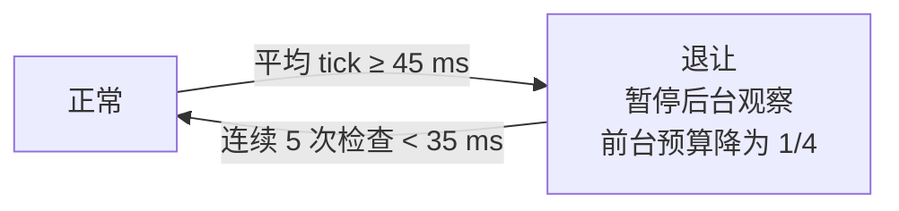

<!-- nav:top -->
<div align="right">

🌐 **简体中文** · [English](../en/Performance.md) · 📖 [README](../../../README.md) · 🏠 [Wiki 首页](Home.md)

</div>
<!-- /nav:top -->

# 🚀 性能

目标：**世界采样的工作量始终有界，服务器忙碌时主动退让。** 模型请求在独立的工作线程中进行，不占用主线程。

## 每 tick 预算

视觉射线、局部空间调查、粒子复核和后台检查**共享**一份预算，不随玩家人数相乘：

| 预算 | 默认 | 说明 |
|---|---|---|
| 时间 | 2 ms | 软预算，每访问一个格子前检查 |
| 射线 / 调查 / 标记单位 | 256 | 全服共享 |
| DDA 或调查格子 | 8192 | 耗尽时长射线在中途暂停，下一 tick 继续 |

不同玩家按最多 32 个格子的切片轮换；同一 tick 内缓存方块、表面属性与区块可访问性，下一 tick 清空。只访问已发送给玩家且仍加载的区块，**绝不触发区块加载**。

## 负载退让



- 每 20 tick 检查一次平均 tick 时间；阈值针对 20 TPS。
- 手动采样可以回收后台占用的任务槽。
- 后台玩家轮转每 5 tick 检查一人（每秒最多 4 人）。

## 其他有界资源

| 资源 | 上限 |
|---|---|
| AI 工作线程 / 队列 | 4 / 32，满时直接拒绝并且不采集上下文 |
| 日志队列 | 256 条，拥堵时丢弃并计数 |
| 地点记忆 I/O | 单独的有界队列，同一玩家的重复保存会合并 |
| 纹理缓存 | 64 MiB 解码像素 + 4096 个状态 + 8192 个坐标变体 LRU |
| 渲染队列 | 单线程，有界 |

## 监控

`/pandaadmin status` 显示最近 512 tick 的 p95、累计最大耗时、访问格子数、方块读取、缓存命中、退让 tick、渲染队列与丢弃日志。整服性能请结合 [spark](https://spark.lucko.me/)。

## 保守配置

较弱的机器或繁忙的服务器可以先使用：

```yaml
panda:
  perception:
    observe_seconds: 60
    entity_radius: 12
    max_entities: 8
  vision:
    width: 96
    height: 54
    max_distance: 48
    rays_per_tick: 128
    cells_per_tick: 4096
    time_budget_ms: 1
    max_concurrent_captures: 1
    max_debug_particles: 12
    save_images: false
```

尺寸、距离与预算应一起降低。只减小预算而保持大图和远距离，可能经常触发 200 tick 超时。

## 边界

这不是硬实时保证：单次原生 API 调用（例如实体空间查询）无法被插件中途打断，GC、其他插件也可能造成卡顿。高密度农场附近建议降低 `entity_radius` 或关闭后台感知。

完整的测量方法与基线对比见仓库中的 [docs/performance.md](../../performance.md)。

<!-- nav:bottom -->
---

<div align="center">

⬅️ [🔑 权限与管理命令](Permissions-and-Admin.md) &nbsp;·&nbsp; [📚 目录](Home.md) &nbsp;·&nbsp; [🛡️ 安全与隐私](Privacy-and-Security.md) ➡️

</div>
<!-- /nav:bottom -->
