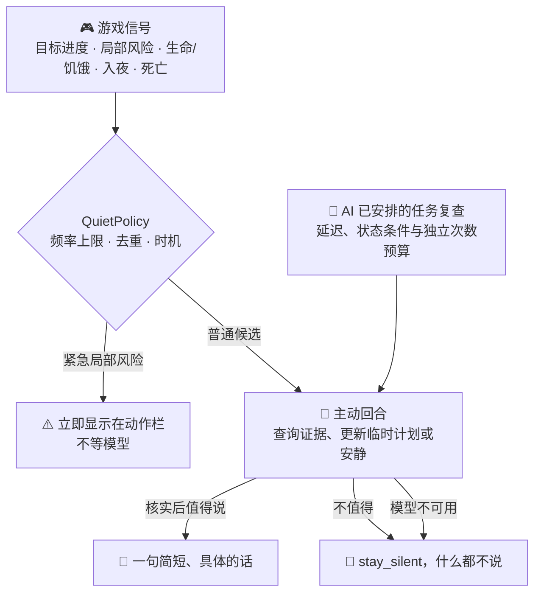

<!-- nav:top -->

🌐 **简体中文** · [English](../en/Proactive-Assistant.md) · 📖 [README](../../../README.md) · 🏠 [Wiki 首页](Home.md)

<!-- /nav:top -->

# 🔔 主动式助手

> 好的助手大多数时候是安静的。Panda 只在**真的有用**的时刻开口，而且每一次开口都由 Agent 先核实、再判断。

## 工作流程

## 会触发主动回合的信号

| 信号 | 何时出现 | Panda 可能说 |
|---|---|---|
| ✅ 目标材料已齐 | 你设定的目标物品材料都在背包里了 | “铁镐的材料齐了，旁边就有工作台。” |
| 🛠️ 顺路制作 | 材料齐全且附近观察到工作台 | 同上，并指出工作台位置 |
| ⛏️ 出发准备 | 设定采矿目标后离开家 8 格 | “火把只剩 3 个，要不要先补点？” |
| ❤️ 生命 / 饥饿偏低 | 数值持续偏低 | “饥饿值快见底了，背包里有面包。” |
| 🌙 入夜仍远离家 | 天黑时你离家很远 | “天黑了，家在东北方 230 格。” |
| 💀 刚刚死亡 | 你死亡后 | “你在矿洞入口附近死了，物品约 5 分钟后消失，要我带路吗？” |
| ⚠️ 局部风险 | 前方坠落、岩浆等 | 直接在动作栏提示，不经过模型 |

## 主动回合的约束

- **游戏数据只读**：例如 `goal_status`、`locate_place`、`nearby_entities`、`last_death`、`economy_balance`、`regions_here` 等，外加临时计划、有限复查和 `stay_silent`。
- **不能**提出命令、修改游戏目标、设置游戏提醒或改变玩家的玩法状态；临时计划更新只影响助手的工作状态。
- 回答要求一句话、约 40 字以内，说明“发现了什么”和“建议做什么”，不寒暄、不提问。
- 普通消息最终由 AI 判断。模型不可用或主动 Agent 被关闭时保持安静；不发送预设候选文案。

## AI 安排的任务复查

除了上面的游戏事件，AI 还能为玩家已经提出的多步任务维护计划，选择按时间或状态变化进行复查。复查带上近期对话、原始请求、当前任务和最新状态，由 AI 核实进展后决定继续等待、调整计划、提醒或保持安静。简单问题不应自动建立持续任务。

默认每次至少等待 60 秒、每项请求最多 3 个自动复查回合，独立于下表的游戏事件候选频率。相同快照不会触发 `state_change` 复查；计时只触发一次评估，后续必须由 AI 再次明确安排且仍有预算。每个复查回合仍受 `panda.agent.max_steps` 限制，可能多次调用模型。到期后再等 30 分钟仍不能开始时会丢弃。新的玩家提问、安静模式、离线、清除会话或重载会取消后台工作。

临时计划不会在重启后恢复，也不授权命令执行或长期记忆变更。详细说明与工具见[智能体运行时](Agent-Runtime.md)。后台几何观察仍不调用模型；事件评估与 AI 安排的复查会增加模型请求和费用。

## 频率与打扰控制

| 规则 | 默认值 |
|---|---|
| 事件触发的普通评估最小间隔 | 15 分钟（`perception.suggestion_seconds: 900`） |
| 每滚动半小时事件评估最多 | 2 条（`perception.routine_per_half_hour: 2`，设为 0 关闭） |
| 同一事实 | 去重，不会反复提醒 |
| 待发送队列 | 只保留一条最有价值的建议，20 秒内没有合适时机就丢弃 |
| 战斗、放置/破坏、交互后 | 普通建议延迟 5 秒 |
| 条件失效 | 材料又不够了、任务取消、离开相关位置、离线等都会撤销建议 |

局部即时风险使用单独的短时去重，不受普通条数限制。

## 开关

| 想做的事 | 方法 |
|---|---|
| 玩家自己关闭 | 对 Panda 说“别打扰我”，恢复说“可以提醒我了” |
| 关闭 AI 主动消息与任务复查 | `panda.agent.proactive: false` |
| 完全关闭主动建议 | `panda.perception.proactive: false` |
| 关闭全部感知、目标与记忆 | `panda.perception.enabled: false` |

安静模式下目标进度条也会隐藏，但仍可以随时主动提问。

## 后台观察

在辅助模式下，插件每 30 秒最多安排一次 **32×18**、24 格以内的低分辨率几何观察，供 Agent 之后用 `recall_surroundings` 回忆。后台观察：

- 不读取纹理、不写 PNG；
- **不调用模型、不产生费用**；
- 需要 `pandagpt.vision` 权限（默认仅 OP），普通玩家不会因为升级插件就被自动观察；
- 服务器负载高时自动暂停，详见 [性能](Performance.md)。

<!-- nav:bottom -->
---

⬅️ [📜 技能与提示词](Skills-and-Prompts.md) &nbsp;·&nbsp; [📚 目录](Home.md) &nbsp;·&nbsp; [👁️ 视觉与感知](Vision-and-Perception.md) ➡️

<!-- /nav:bottom -->
