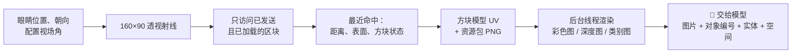

<!-- nav:top -->
<div align="right">

🌐 **简体中文** · [English](../en/Vision-and-Perception.md) · 📖 [README](../../../README.md) · 🏠 [Wiki 首页](Home.md)

</div>
<!-- /nav:top -->

# 👁️ 视觉与感知

不需要任何客户端模组，PandaGPT 就能在服务器端**重建玩家眼前的第一人称画面**：用射线逐像素检测方块，再按原版资源包的模型与纹理着色，交给支持图片的模型去“看”。


## 🎯 `look`：重建画面



| 输出 | 内容 |
|---|---|
| `color.png` | 真实纹理、模型 UV、近似生物群系染色与表面光照的场景图 |
| `depth.png` | 射线距离灰度：近亮远暗 |
| `labels.png` | 材质类别颜色 |
| `metadata.json` | 相机参数、逐像素距离与对象编号、有效性 mask、实体与局部空间结果 |

开启 `save_images` 时，每位玩家只保留最新一组文件，位于 `captures/<UUID>/`，不公开到 HTTP。

**渲染细节**：读取方块状态的 variants / multipart、模型父级与纹理引用；处理面 UV 旋转、模型旋转与 uvlock；楼梯、半砖、原木轴向、熔炉朝向使用各自模型；草和树叶读取颜色表；动画纹理取第一帧。缺失的模型显示紫黑棋盘格，灰色棋盘格表示无法访问的数据，蓝色表示范围内没有命中（不等于天空）。

### 官方纹理

插件启动时会**自动从 Mojang 官方下载并校验**原版纹理，详见 [安装与升级](Installation.md#textures)。也可以叠加服务器资源包：

```yaml
panda:
  vision:
    textures:
      enabled: true
      auto_download: true
      packs:
        - 'assets/vanilla-26.3.zip'   # 自动下载
        - 'assets/server-pack.zip'    # 服主自备，覆盖前面的包
      cache_mib: 64
```

## 🔢 对象编号与 `focus_object`

每次采样会把相邻、空间相接的同类表面合并为**区域**，并给出编号（最多 48 个）；相邻的熔炉、工作台等交互方块保留独立编号。图片上会叠加 `#编号`。

当玩家说“左边那个熔炉”，Agent 会：

1. 调用 `look` 得到编号；
2. 调用 `focus_object(#3)`。服务器会核对编号、观察有效期、玩家的世界/朝向/权限以及目标方块的**当前**状态，**不接受模型编造的坐标**；
3. 用最多 12 个经过遮挡复核的轮廓点，以只有该玩家能看到的粒子把对象勾出来（需要 `pandagpt.vision.debug`）。

## 🧱 局部空间调查

复制玩家周围 **7×7×7** 个格子的真实碰撞盒，报告前方 1～3 格、左中右三列的：站立净空、落脚面、落差、危险或未知。

- `PASSABLE_LOCAL` 只证明该列有 0.6×1.8 的站立空间与支撑，不代表整条路线可达。
- 建筑分析提供“开口候选”和局部空格连通性，但不等于“建筑完全封闭或气密”。

## 🐺 实体观察

在主线程复制实体的 UUID、类别、位置、碰撞箱、掉落物数量与怪物当前目标；只查询限定半径内、已发送且已加载的区块，并尊重 `player.canSee`。后台用同一相机投影，取 3×3 条射线与方块深度比较，标记为 `VISIBLE_SAMPLES`、`OCCLUDED_SAMPLES`、`OUTSIDE_FOV` 或 `UNKNOWN_SAMPLES`。可见实体会叠加黄色 `E编号` 框（不渲染实体纹理）。


## ⏱️ 连续观察与失效

- 短时观察按“世界 + 方块坐标”比较，不会因为转头误报方块消失。
- 实体以 UUID 比较，并用同一个眼睛位置计算径向运动，不会把“玩家向前走”误判为“怪物靠近”。
- 已知坐标发生放置、破坏、交互、红石、流体、燃烧、爆炸、活塞等变化时，相关观察与记忆立即失效。
- 进行中的采样只有在已命中的方块或已复制的格子发生变化时才取消；附近的流水、熔炉、红石不会让采样反复失败。

## 📍 地点记忆

- 按玩家 UUID 保存到 `memory/<UUID>.json`：世界、坐标、方块状态、来源、记录时间、最后验证时间，以及目标与个人笔记。
- 每人最多 32 个地点；自动记录的交互方块优先淘汰，手动标记的地点保留。
- 睡床或使用重生锚时自动记为“家”；你亲口指定的家优先。
- 加载与保存在独立的有界 I/O 队列中完成，并原子替换文件，主线程从不读写磁盘；损坏的文件不会被覆盖。
- 不会读取其他玩家的背包或箱子内容，也不会保存完整的世界地图。

## 🎯 目标

只有你明确说出想做什么时才会设定目标，例如“我想做一把铁镐”。物品目标根据真实合成配方与背包判断材料，使用一条 BossBar 显示进度；持有目标数量后完成并短暂显示 ✓。采矿目标会报告火把、镐与食物，离家时提示准备情况。

## ⚙️ 参数

| 配置 | 默认 | 说明 |
|---|---|---|
| `vision.width` × `height` | 160×90 | 每个像素一条射线 |
| `vision.vertical_fov` | 70 | 服务器无法读取客户端真实 FOV |
| `vision.max_distance` | 96 | 同时受视距与已加载区块限制 |
| `vision.max_concurrent_captures` | 2 | 同时进行的采样数 |
| `vision.timeout_ticks` | 200 | 超时取消 |
| `vision.cooldown_seconds` | 10 | 每位玩家的冷却 |
| `perception.observe_seconds` | 30 | 后台观察间隔 |
| `perception.scene_ttl_seconds` | 60 | 观察有效期 |

调度预算（每 tick 2 ms、256 条射线、8192 个格子）见 [性能](Performance.md)。

## 🚧 能力边界

重建的是服务器端的方块碰撞与资源包纹理，**不是客户端截图**：不含实体模型、箱子等特殊渲染器、光影、HUD、手持物品；玻璃和水只检测第一层；不支持 OptiFine / CTM。服务器也无法得知客户端真实 FOV、窗口比例或客户端假方块。

<!-- nav:bottom -->
---

<div align="center">

⬅️ [🔔 主动式助手](Proactive-Assistant.md) &nbsp;·&nbsp; [📚 目录](Home.md) &nbsp;·&nbsp; [✨ 创意功能](Creative-Features.md) ➡️

</div>
<!-- /nav:bottom -->
