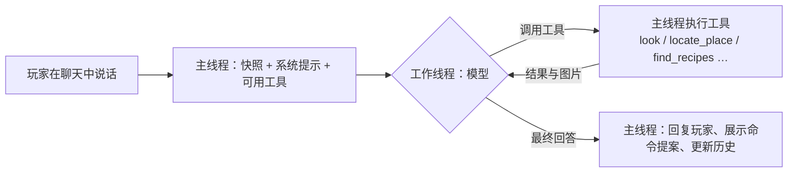
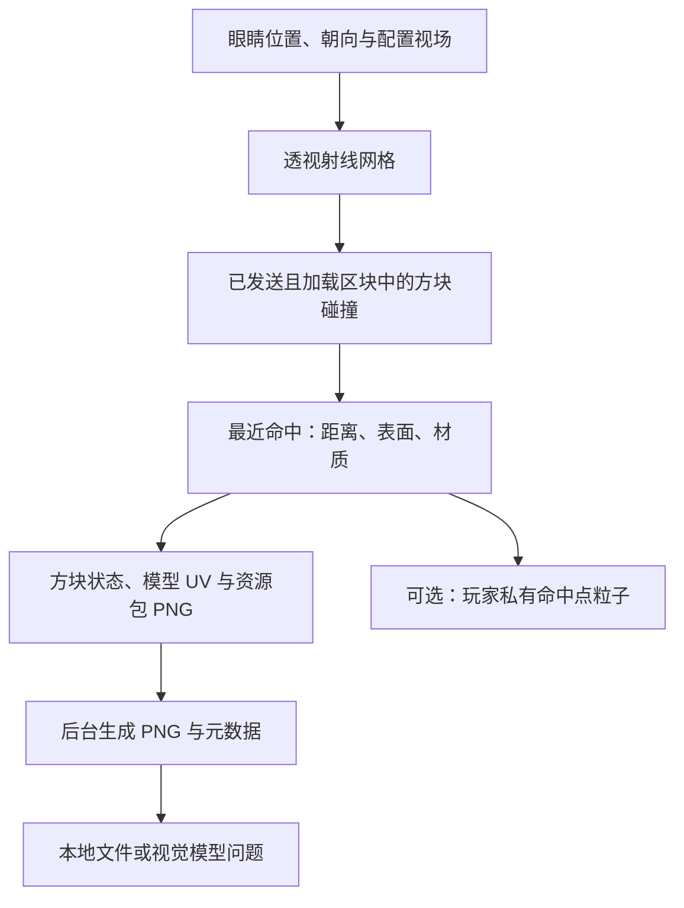

# 🐼 PandaGPT 3.0

为 **Minecraft Java 版 / Paper 26.3** 提供真实纹理视觉重建、对象指代、局部空间与实体观察、地点记忆、安静的目标辅助，以及需要玩家确认的命令提案。

> 26.3 是 Minecraft/Paper 版本，运行与构建要求 **JDK 25**。本版本不支持原来的 Spigot 1.12.2，也未声明 Folia 兼容性。

## 安装与构建

1. 在 JDK 25 和 Maven 3.9+ 环境执行：
   ```bash
mvn --batch-mode --no-transfer-progress clean verify
```
2. 将 `target/PandaGPT-3.0.0.jar` 放入 Paper 26.3 的 `plugins` 目录，重启服务器；升级时移除旧 PandaGPT JAR。
3. 修改 `plugins/PandaGPT/config.yml`：选择服务商、模型、API 地址与密钥。也可通过服务器进程环境变量 `PANDAGPT_OPENAI_API_KEY` / `PANDAGPT_GEMINI_API_KEY` 提供密钥；非空环境变量优先于文件。
4. 在 `knowledge.md` 中填写本服真实的规则、经济、领地、传送及插件说明。
5. 执行 `/pandaadmin reload`，通过 `/pandaadmin status` 查看所选服务是否已配置。

GitHub Actions 会以 Java 25 运行测试并生成可下载的插件构建产物。Paper API 固定为 `26.3.build.175-stable`，避免构建意外跨入未来版本。更新 Paper 构建时修改 `paper.version` 并重新验证。

## 多语言

所有面向玩家与控制台的文字都来自语言文件，内置 12 种语言：简体中文 `zh_CN`、繁體中文 `zh_TW`、English `en_US`、日本語 `ja_JP`、한국어 `ko_KR`、Español `es_ES`、Français `fr_FR`、Deutsch `de_DE`、Русский `ru_RU`、Português (Brasil) `pt_BR`、العربية `ar_SA`、हिन्दी `hi_IN`。

```yaml
panda:
  language:
    default: 'zh_CN'   # 控制台与无法匹配的客户端使用的语言
    per_player: true   # 按玩家客户端语言显示；关闭后所有人使用 default
```

- 开启 `per_player` 时按客户端语言就近匹配：`zh_HK`/`zh_MO`/繁体脚本 → `zh_TW`，`pt_PT` → `pt_BR`，`es_MX` → `es_ES`，其他未内置的语言回退到 `default`。
- 首次启动会把内置语言文件复制到 `plugins/PandaGPT/lang/`。修改其中任意键后执行 `/pandaadmin reload` 即可生效；文件中缺少的键自动使用内置文本，升级插件不会覆盖已修改的文件。
- `{0}`、`{1}` 等是参数占位符，翻译时请保留。模型回复的语言由模型决定：系统提示会要求“用提问的语言回答，无法判断时使用玩家客户端语言”。

## 使用：零命令，只需要说话

玩家没有任何命令。在聊天开头说 `panda`（或 `@panda`），像跟人说话一样就行，剩下的交给 Agent：它会自己决定要不要看一眼你眼前的画面、翻一下背包、查服务器资料、算方向、记地点或设目标，必要时连续调用多个工具，最后用一两句话回答。

| 你说 | Agent 会做什么 |
|---|---|
| `panda 我附近安全吗？` | 查看附近生物、时间与光照，结合你的血量和装备给建议 |
| `panda 左边那个熔炉怎么用？` | 调用 look 重建视角，用编号锁定熔炉，再用粒子把它标出来 |
| `panda 我家在哪？怎么回去？` | 计算距离、高度差和该往哪边转 |
| `panda 记住这里是我家` / `panda 把这个箱子记下来` | 记录地点；“这个”会先看一眼再记 |
| `panda 我想做一把铁镐` | 设定目标、查本服真实配方、对照背包告诉你还差什么 |
| `panda 我现在能做什么？` | 列出背包材料现在就能合成的东西 |
| `panda 本服能圈地吗？` | 检索 knowledge.md，只按本服资料回答 |
| `panda 帮我回出生点` | 提出命令，等你点击确认或回答“执行吧” |
| `panda 别打扰我` / `panda 忘掉刚才的对话` | 切换安静模式 / 清空对话历史 |

**你什么都不说也会发生的事：**

- 睡床或使用重生锚时，自动把重生点记为家。你亲口指定的家优先，不会被覆盖。
- 主动式 Agent：插件感知到值得注意的事（目标材料齐了、路过工作台、离家采矿准备不足、生命或饥饿偏低、入夜仍远离家），会交给 Agent 判断此刻是否值得开口；它可以先用只读工具核实，再说一句简短的话，或者选择保持安静。普通提醒有严格的频率上限，安静模式下完全不打扰。
- 后台低频观察周围的几何结构，供 Agent 回忆环境；后台观察不调用模型。
- 坠落、岩浆这类紧急的局部风险直接显示在动作栏，不等待模型。

触发词只在聊天开头匹配，聊天中间出现的 panda 不会触发；聊天入口尊重其他插件已取消的事件。

服主唯一的命令：

| 命令 | 行为 |
|---|---|
| `/pandaadmin reload` | 验证后重载配置、语言、技能、提示词、资料与配方索引；失败保留原服务 |
| `/pandaadmin clearchat` | 清除全服会话、在途回合及待确认动作 |
| `/pandaadmin status` | 查询服务、技能与工具数量、队列与视觉状态 |

## Agent、技能与提示词



**Agent 循环**：每句话是一个回合。模型可以在一个回合内多次、并行地调用工具，看到结果后再决定下一步；所有工具都切回服务器主线程执行，需要时间的工具（例如 look 等待射线采样）会让回合等待其完成。步数、工具调用数、总时长和单个结果长度都有上限（`panda.agent.*`）；预算用尽时 Agent 被要求立即用已有信息作答。

**技能（Skill）**：位于 `plugins/PandaGPT/skills/*.md`，首次启动时从插件复制。每个技能是带头部的 Markdown：

```markdown
---
name: places
description: 记住、忘记、列出地点，并告诉玩家某个地点在哪个方向、有多远。
tools: remember_place, forget_place, list_places, locate_place
always: false
---
给模型的详细说明……
```

系统提示只列出技能名称和一句话简介；模型需要时调用 `load_skill` 读取全文（渐进式披露，节省上下文）。`always: true` 的技能直接放进系统提示。一个工具只有在某个已启用技能的 `tools` 中列出时才会提供给模型。

内置技能：`panda`（核心行为，常驻）、`places`、`goals`、`crafting`、`survival`、`vision`、`commands`、`server-guide`。服主可以：

- 修改内置技能文件，调整 Agent 的行为方式；
- 新建只有说明、没有工具的技能，例如 `skills/events.md` 写本周活动，Agent 会在相关时自行加载；
- 在 `panda.agent.disabled_skills` 中关闭技能，例如 `[commands, vision]`，对应工具随之消失。

**提示词（Prompt）**：`plugins/PandaGPT/prompts/system.md`（每次对话的系统提示）与 `proactive.md`（主动回合）。模板使用 `{{personality}}`、`{{language}}`、`{{skills}}`、`{{snapshot}}`、`{{memory}}`、`{{knowledge}}`、`{{pending}}`、`{{signal}}` 等变量，修改后执行 `/pandaadmin reload` 生效。

**工具一览**

| 技能 | 工具 |
|---|---|
| panda | get_player_status、set_assistance、forget_conversation、respond_to_pending_action、stay_silent（仅主动回合） |
| places | remember_place、forget_place、list_places、locate_place |
| goals | set_goal、clear_goal、goal_status |
| crafting | find_recipes、craftable_now |
| survival | nearby_entities、world_conditions |
| vision | look、focus_object、recall_surroundings |
| commands | propose_command、list_server_commands |
| server-guide | search_server_knowledge |

主动回合只能使用只读工具（以及 stay_silent），不能提出命令或修改玩家状态。工具结果、资料与快照在提示词中被声明为数据而非指令。

## 命令动作

**任何自然语言回复中的 /命令都不会被自动执行。**

命令只能来自 commands 技能的 propose_command 工具，在回合结束后连同确认/取消按钮展示给玩家。开启需要同时满足：

- `panda.command_awareness.enabled: true`；
- `allow_execution: true`；
- 命令根名称在 `allowed_commands` 中，且不在拒绝列表中；
- 玩家拥有 `pandagpt.use` 和 `pandagpt.actions`；
- 玩家在有效期内点击确认按钮（服务器端一次性点击回调，不依赖任何命令），或明确告诉 Agent“执行吧”。Agent 只有在玩家下一句话清楚表示同意时才能调用 respond_to_pending_action，每个回合最多一次；不确定时必须先问。

默认仅允许 help，动作执行默认关闭。执行身份只能为 player，绝不赋予 OP 或通过控制台代执行。权限在提案与确认时重新检查；最终由服务器按玩家现有权限派发。命名空间命令、换行和命令串联被拒绝；op、deop、stop、reload、execute、sudo 等管理/包装命令始终被拒绝。

每批动作一次性消费，任何拒绝、失败或权限变化都会停止。确认码与玩家 UUID 绑定，有过期时间，不能重放。Bukkit 的派发返回值只表示命令被接受，不能证明具体游戏动作成功；请查看对应命令的反馈。

允许列表的粒度是命令根名称。服主应审核该命令全部参数与其权限语义；不要加入可以间接执行其他命令的插件包装器。

## 环境和对话

- 每个回合只附带精简快照（名字、生命、饥饿、模式、维度、位置、朝向、手持物品）以及地点记忆与目标；背包、附近生物、环境、配方、资料、视觉都由 Agent 按需调用工具获取。
- 游戏状态全部在服务器主线程采集；工作线程只处理不可变的文本与图片。
- 合成使用真实 ShapedRecipe / ShapelessRecipe 索引，按实际物品与数量匹配，不重复使用同一件材料。索引在启动/重载时刷新。配方结果不保证已解锁、已到达工作台或未被其他插件阻止。
- 服务器资料按标题与段落切分后检索，Agent 只读取相关段落，而不是每一步都携带整份 knowledge.md。
- 历史以 UUID 隔离，只保留问题、最终回答与用过的工具名，按字符预算移除较旧的完整轮次。
- 每位玩家同时只有一个在途回合。全服线程池、队列、会话数量、输入长度、输出 token、响应体大小、Agent 步数与工具调用数都有上限。
- 超时、离线、清除、重载及停服都不会继续向玩家发送旧回合的结果，进行中的回合会在下一步前停止。
- 仅对 HTTP 429/502/503/504 与连接失败做有限重试（`requests.retries`，默认 1 次），优先遵守 `Retry-After`；重试只会重新获取模型回复，不会重复执行工具。
- Gemini 3 的多轮函数调用需要原样带回思考签名（thoughtSignature），插件会自动保存并回传。

## 配置与旧版迁移

首次读入 v1 配置时创建 `config-v1-backup.yml`，保留密钥、模型名、代理和人格配置。旧 `history_size` 是消息数，迁移为向下取整的完整问答轮数；新增配置采用 v2 默认值。

旧 Gemini URL 的 `?key=%s` 不再用于传输密钥；请求使用 API key 头。API 地址必须为 HTTPS，不能带查询参数或 URL 凭据。旧模型名称会保留，服主需自行检查账号当前可用模型并修改；不要假设 2025 年的默认模型仍可使用。

旧 executor 为 op/console 时会明确拒绝配置，需改成 player。默认代理关闭；若使用代理，请确保端口对应 HTTP CONNECT 代理，而非仅支持 SOCKS 的端口。JDK 默认禁止在 HTTPS 隧道上使用 Basic 代理认证，配置了代理账号时需在服务器 JVM 参数中加入 `-Djdk.http.auth.tunneling.disabledSchemes=`，否则账号密码不会生效；插件启动时检测到这种情况会在控制台警告。

`logging.enabled` 控制文件日志；默认仅记录 UUID 与事件，`logging.conversations` 可显式开启原始对话日志。日志采用 UTF-8 并轮转。所采集的游戏状态及 knowledge.md 会随请求发送给服主配置的模型端点。

## 代码规范

- 格式：`mvn spotless:apply` 使用 palantir-java-format 统一格式化；`mvn verify` 会检查格式，不符合时构建失败。
- 注释一律使用中文。类型使用 `/** 一句话职责说明。线程：……。 */` 形式的 Javadoc，说明职责与线程约束；需要说明的公共方法使用 Javadoc；行内注释写在代码上方的单独一行，以 `//` 开头，解释“为什么”而不是复述代码。
- 面向玩家或控制台的文字不得硬编码，统一通过 `Lang` / `Msg` 引用语言文件中的键；新增键时需同时补全 12 个语言文件，`MessagesTest` 会检查各语言的键与占位符是否一致。

## 权限

| 权限 | 默认 | 用途 |
|---|---|---|
| pandagpt.use | 所有玩家 | 和 Panda 说话 |
| pandagpt.actions | OP | 接收并确认命令提案（commands 技能） |
| pandagpt.vision | OP | look、focus_object 与后台观察 |
| pandagpt.vision.debug | OP | 用粒子显示射线命中点与对象轮廓 |
| pandagpt.admin | OP | 重载、状态查询、清除全服会话 |

## 验证范围与后续方向

自动测试覆盖多步工具调用的线格式（含 Gemini 思考签名与图片）、Agent 循环的预算与失败处理、技能与提示词加载、工具在主线程执行、命令提案与自然语言确认、主动回合的发言/沉默/退回、会话隔离、队列上限、超时与旧回调丢弃。部署前仍应在独立的 Paper 26.3 测试服上核对插件组合、API 账户和动作白名单。

本版提供真实资源包纹理、实体框注释、局部碰撞与连接性判断、低频观察和持久地点记忆。客户端真实截图、完整实体渲染、多层透明合成和全局路线规划仍是后续方向。知识检索目前读取本地小文档；不包含自动公告或长期对话摘要。

## 对象、空间与连续观察

每次采样把像素与命中方块坐标、状态和距离绑定。相邻且空间相接的同类表面合并为区域；相邻熔炉/工作台等交互方块保留独立编号。编号只属于本次 capture_id，最多 48 个，不代表观察到了完整物体。图片叠加 #编号，metadata.json 包含 `scene_objects` 和与原采样对齐的 `scene_object_id_pixels`。

Agent 通过 focus_object 工具指认对象，只能使用最近一次 look 的编号。服务端核对编号、观察有效期、玩家世界/朝向/权限和目标当前方块状态；不接受模型创造的坐标。粒子标记最多 12 个已观察的轮廓点，逐点重新射线确认遮挡，共享采样预算。需要 `pandagpt.vision.debug`。是否需要看一眼由 Agent 根据问题自行判断。

局部空间调查复制玩家脚下周围 **7×7×7** 个格子的真实碰撞盒，分 tick 与图像射线共享预算。分别报告前方 1～3 格、左右三列的站立净空、落脚面、落差、危险或未知。`PASSABLE_LOCAL` 只证明该落脚列的 0.6×1.8 站立空间与支撑条件，不证明整条路线可达；未实现跳跃、爬行或寻路。

建筑分析提供两种证据：画面内部、被已知命中包围的无命中区域作为“开口候选”；局部空格连通分析报告是否接到调查边缘，或是否被完整碰撞立方体包围。半砖/栅栏等部分形状、缺失格子和流体边界会保留未知。局部碰撞封闭不等同完整建筑无缺口或气密性，不把背景蓝色当作天空证据。

实体在主线程复制 UUID、类别、位置、碰撞包围盒、掉落物类别/数量及 Mob 当前目标。只查询限定半径、已发送且加载区块，并尊重 player.canSee；扫描至多 256 个候选，保留配置数量的候选。后台用同一相机投影，并在包围盒中取 3×3 条射线，与方块深度/未知 mask 比较。`VISIBLE_SAMPLES` 表示存在可见采样点，`OCCLUDED_SAMPLES`、`OUTSIDE_FOV` 和 `UNKNOWN_SAMPLES` 分别记录其他情况。可见实体叠黄色 E编号框，不渲染实体纹理；depth/labels 仍只描述方块。玻璃等首层碰撞仍可能保守遮挡实体。

短时观察按世界 UUID＋方块坐标比较共同采样的状态，不因转头或像素位置变化报告方块消失。相同位置、投影、范围且两次没有未知像素时，也比较开口候选面积与局部空格连接性，提供“缺口缩小”的采样证据。实体以 UUID 和各自观察时间比较，用同一个当前眼睛位置计算径向运动，避免把玩家向前走误判为怪物靠近。只有服务器目标字段支持时才说目标是玩家。比较窗口为 60 秒，默认观察有效期为 60 秒。

已知坐标发生放置、破坏、交互、红石、流体、燃烧、实体改块、爆炸或活塞变化时，使对应观察/记忆失效；进行中的采样只有在已命中的方块或已复制的局部调查格子发生变化时才取消，附近的流水、熔炉或红石不会让采样反复失败。没有事件的其他插件直接改块可能只能在下一次观察时发现，所以观察始终带时间，不能当成永远有效的状态。

## 安静的主动辅助与地点记忆

默认辅助模式，每 30 秒最多安排一次 **32×18**、24 格以内的几何观察；移动/转头、容量限制和权限变化可能使观察取消或延后。自动观察不读取纹理、不写 PNG，也不调用模型 API。`pandagpt.vision` 默认 OP，因此普通玩家不会因安装升级就自动获得视觉观察权限。

主动候选来自实际目标进度、已确认的局部风险与行动边界，时间到了可以完全没有消息。普通文字建议默认至少间隔 **15 分钟**、每滚动半小时最多 **2 条**，同一事实去重；只保留一条最有价值的待发送建议，20 秒后仍无合适时机便丢弃。局部即时风险使用短 ActionBar、短有效期和独立去重，不受常规条数限制；它不是完整的危险预警系统。

目标只在你明确说出想做什么时设定（例如“panda 我想做一把铁镐”），单纯提问或路过某处不会自动创建任务。物品目标依据真实合成台配方与背包库存判断材料匹配，使用同一条 BossBar 更新，持有目标数量后完成并短暂保留 ✓。材料匹配不保证配方已解锁或服务器允许制作；完成只证明物品数量，不推断其获取方式。采矿任务报告火把、镐和食物数量；从你的家（自动记住的重生点、你指定的家，或名为“基地/家/base/home”的地点）8 格范围内离开时，可提示当前准备情况。接近观察到的工作台且目标材料齐全时，提供顺路制作建议。

战斗受伤、放置/破坏或交互后，常规建议延迟 5 秒；材料再次不足、任务取消、离开相关位置、观察失效、关闭模式或离线都会撤销相应建议。关闭主动辅助会隐藏目标条，但可继续主动提问、手动观察和查看目标状态。后台推理只产生候选，提醒调度由确定的规则控制；当前没有自主行动、模型生成的主动闲聊或自动推断凝视意图。

地点按玩家 UUID 写入 `plugins/PandaGPT/memory/<UUID>.json`，保留世界 UUID、坐标、方块状态、来源、记录时间与最后验证时间。最多 32 个地点，自动记录的交互方块优先被淘汰，保留用户显式标记；超过 32 个全部手动地点时按最旧记录淘汰。个人模式与目标跨重启保留。不会读取其他玩家背包、箱子内容或保存完整世界地图。记忆会随主动提问作为历史数据发给所选模型，默认每次最多附加 12 个当前世界地点。

加载/保存使用独立有界 I/O 队列与原子替换，主线程不读写记忆文件；写入在后台完成，随后可以问“panda 你记得哪些地方”核对。无效/损坏文件不会被覆盖，管理员需修复后重新加载玩家。说“panda 忘掉刚才的对话”只清空对话历史，地点与目标保留；要删除某个地点，直接说“panda 忘掉某某”。


以上框来自人工构造的实体包围盒，图中没有村民模型，验证的是投影和遮挡接口。

## 射线视觉重建与粒子反馈

无需客户端模组即可生成带真实 PNG 纹理的第一人称方块图、深度图与材质类别图。它是服务器数据生成的图，不是客户端截图。

### 准备真实纹理

默认开启纹理模式。先从本项目取得 `tools/download_vanilla_assets.py`，在服务器工作目录执行：

```bash
python3 tools/download_vanilla_assets.py --version 26.3 --output plugins/PandaGPT/assets/vanilla-26.3.zip
```

脚本从 Mojang 官方版本清单获取客户端，校验版本文件和客户端的 SHA-1 与客户端大小，只提取 blockstates、方块模型、PNG、动画元数据与生物群系色表；不会执行客户端代码。插件 JAR 不打包游戏资源。下载完成后执行 `/pandaadmin reload`。

也可直接读取本地 26.3 客户端 JAR、资源包 ZIP 或解压后的资源包目录。在 `config.yml` 配置相对插件目录的路径（也支持绝对路径）：

```yaml
panda:
  vision:
    textures:
      enabled: true
      packs:
        - 'assets/vanilla-26.3.zip'
        - 'assets/server-pack.zip'
      cache_mib: 64
```

后面的包覆盖前面的同路径文件，基础包提供自定义包未覆盖的资源。只配置实际存在的包。应使用与玩家相同版本、同一套资源包；服务器无法自动读取玩家私人资源包。没有资源时拒绝采样并提示安装，避免把基础色当成纹理；仅在明确设置 `textures.enabled: false` 时使用旧地图色模式。

渲染器读取方块状态 variants/multipart、模型父级与纹理引用，用命中面的三维位置计算 UV，处理面 UV 旋转、模型旋转与 uvlock，然后从对应 PNG 取样。楼梯、半砖、原木轴向和熔炉朝向使用各自模型。草/树叶读取颜色表，水使用真实 still 纹理。模型与图片读取在后台运行，图片缓存和文件大小受限。

### 采样与输出

Agent 调用 look 时，插件在主线程分 tick 采样，在后台线程渲染 PNG，完成后把图片、对象编号、实体和局部空间证据作为工具结果交还给 Agent。玩家移动、转头或超时会让 look 以原因结束，Agent 会请玩家站稳再试。模型/兼容 API 必须支持图片和函数调用；历史中不保留图片。开启 `save_images` 时每位玩家的最新一组文件保存在 `captures/<UUID>/`，供服主排查。



粒子模块把已经计算出的命中点显示给该玩家；没有把客户端粒子碰撞作为传感器，也没有粒子碰撞回传。debug 需要单独权限，最多显示配置数量的命中点。碰撞数据来自射线检测。

默认按 **160×90、纵向 FOV 70°、最大 96 格**采样，每个像素对应一条透视射线。DDA 逐格检查，单方块精确射线接口负责楼梯、半砖等碰撞形状。不会调用可能加载区块的 World.rayTraceBlocks；只访问采样开始时已发送给玩家且采样时仍加载的区块，并受玩家报告/服务器发送视距限制。首个不可访问区块终止该射线。

每 tick 的调度循环由所有采样任务、调查格子、粒子复核和后台玩家检查共享 **2 ms 的软时间预算**；同时最多完成 256 条射线/调查/标记单位、消耗 **8,192 个 DDA 或调查格子**。每个格子访问前检查时间和额度，长射线可在内部暂停，下 tick 继续，不把未完成当成天空或未知。不同玩家按最多 32 个格子的切片轮换，同 tick 缓存方块、表面属性和区块可访问性，下 tick 清空。

在常规 20 TPS 下，平均 tick 时间达到 45 ms 时暂停后台观察，前台额度和时间降至四分之一；连续五次每 20 tick 的检查低于 35 ms 后恢复。手动采样可回收后台占用的任务槽。后台玩家轮转每 5 tick 检查一人（每秒最多四人），在线名单由加入/退出事件维护。日志使用 256 条的有界异步队列，拥堵时丢弃新增日志并累计数量；地点失效按坐标索引、同一玩家的重复保存合并，目标配方按产物查询。纹理状态与坐标变体也有有界缓存。

这不是硬实时保证：单次 Bukkit/Paper 原生查询、碰撞盒读取、GC、渲染竞争或其他插件仍可能超时。实体查询移到采样末段，返回候选最多 256 个，后续属性读取受剩余时间约束；原生查询内部不能抢占，负载退让时可以省略实体，空列表不证明没有生物。普通提问的实体/配方上下文同样限制候选、检查截止时间，并在模型队列满时提前拒绝采集。默认允许两人同时采样，超过 200 ticks 取消；位置/视线变化、离线、清除、采样范围内的已知改块事件或重载也会取消。超过预算时优先延迟或取消，手动采样请保持视线稳定。

`/pandaadmin status` 可查看循环最近 512 tick 的 p95、累计最大耗时、访问格子、方块读取、缓存命中、负载退让 tick、渲染队列与丢弃日志。循环耗时不包括其他事件或模型回调，整服验证请结合 spark。完整对比、低负载配置与压测步骤见 [性能说明](docs/performance.md)。

保存位置为 `plugins/PandaGPT/captures/<玩家UUID>/`，每人保留最新一组文件，后续采样覆盖，不公开到 HTTP：

| 文件 | 内容 |
|---|---|
| color.png | 真实 PNG 纹理、模型 UV、近似生物群系染色和表面光照构成的场景图 |
| depth.png | 射线距离灰度：近处亮，远处暗；无效像素需结合 mask 判断 |
| labels.png | 材质类别颜色，调色板在 metadata.json |
| metadata.json | 相机、像素距离、材质/对象 ID、有效性 mask、纹理状态、实体观察与局部空间结果 |

灰色棋盘格表示不可访问数据，蓝色表示范围内没有射线命中，不能把蓝色当成已确认的天空。所有图与元数据使用同一组像素。图中距眼睛的射线距离不等同于相机前向 Z 深度。

缺失或不支持的模型/纹理显示紫黑棋盘格，`texture_mask=2`；成功从 PNG 取样为 1，未使用纹理为 0。半透明纹理按其 alpha 叠在灰色未知背景上，不伪造后方场景，元数据记录 `texture_alpha` 和部分透明像素数。

**还原边界：**重建服务器方块碰撞与资源包纹理，不含实体模型、动态箱子等专用渲染器、光影、HUD、手持物品或第三人称相机。玻璃/水仍只检测第一层命中，花草等视觉模型可能与碰撞形状不同。动画取首个声明帧，随机变体按坐标稳定选取，不保证与客户端相同；染色和光照为近似值，不支持 OptiFine/CTM 等扩展。服务端不能自动读取客户端真实 FOV、窗口比例、视角摇晃或客户端假方块，请按实际设置调整参数。区块“已发送”不能证明客户端已完成渲染；世界也可能在分 tick 采样期间变化。需要像素级真实画面时应接入客户端截图。

真实资源测试可执行 `mvn -Dpandagpt.test.assets=/绝对路径/vanilla-26.3.zip clean verify`；不提供资源路径时仅跳过官方资源测试，运行合成纹理和其他回归测试。CI 会下载并校验官方资源后测试。`OfficialAssetsTest` 还生成 `target/texture-preview.png`：这是人工构造方块场景的射线验证图，不是 Minecraft 服务器截图。


权限 `pandagpt.vision` 和 `pandagpt.vision.debug` 默认均为 OP。文件留在服务器；只有显式视觉问题才发送图片给模型。关闭 save_images 可只在内存中重建/提问，关闭 vision.enabled 停用视觉采样，关闭 perception.enabled 停用新增感知/目标/记忆接口。

官方参考：

- [Mojang 官方版本与客户端下载清单](https://piston-meta.mojang.com/mc/game/version_manifest_v2.json)
- [BlueMap 资源包加载方法](https://bluemap.bluecolored.de/wiki/customization/ResourcePacks.html)
- [block-model-renderer 模型与资源包渲染示例](https://github.com/ewanhowell5195/block-model-renderer)
- [Paper 运行要求](https://docs.papermc.io/paper/getting-started/)
- [Paper 26.3 项目配置](https://docs.papermc.io/paper/dev/project-setup/)
- [Paper 线程调度](https://docs.papermc.io/paper/dev/scheduler/)
- [单方块射线与碰撞形状](https://jd.papermc.io/paper/26.3/org/bukkit/block/Block.html)
- [玩家已发送区块与粒子接口](https://jd.papermc.io/paper/26.3/org/bukkit/entity/Player.html)
