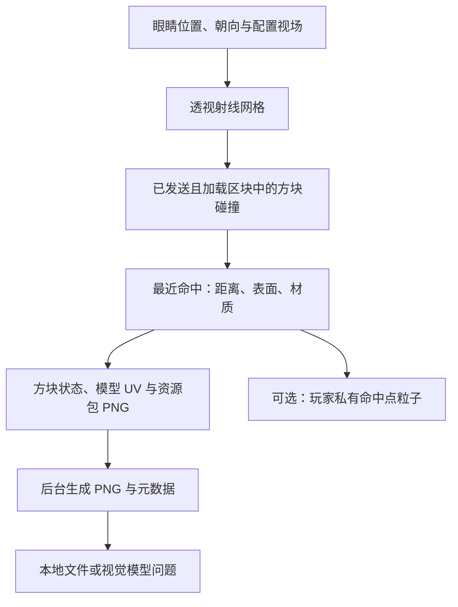

# 🐼 PandaGPT 2.1

为 **Minecraft Java 版 / Paper 26.3** 提供真实纹理视觉重建、对象指代、局部空间与实体观察、地点记忆、安静的目标辅助，以及需要玩家确认的命令提案。

> 26.3 是 Minecraft/Paper 版本，运行与构建要求 **JDK 25**。本版本不支持原来的 Spigot 1.12.2，也未声明 Folia 兼容性。

## 安装与构建

1. 在 JDK 25 和 Maven 3.9+ 环境执行：
   ```bash
mvn --batch-mode --no-transfer-progress clean verify
```
2. 将 `target/PandaGPT-2.1.0.jar` 放入 Paper 26.3 的 `plugins` 目录，重启服务器；升级时移除旧 PandaGPT JAR。
3. 修改 `plugins/PandaGPT/config.yml`：选择服务商、模型、API 地址与密钥。也可通过服务器进程环境变量 `PANDAGPT_OPENAI_API_KEY` / `PANDAGPT_GEMINI_API_KEY` 提供密钥；非空环境变量优先于文件。
4. 在 `knowledge.md` 中填写本服真实的规则、经济、领地、传送及插件说明。
5. 执行 `/pandaadmin reload`，通过 `/pandaadmin status` 查看所选服务是否已配置。

GitHub Actions 会以 Java 25 运行测试并生成可下载的插件构建产物。Paper API 固定为 `26.3.build.175-stable`，避免构建意外跨入未来版本。更新 Paper 构建时修改 `paper.version` 并重新验证。

## 使用

| 输入 | 行为 |
|---|---|
| `@panda 我附近有哪些危险？` | 根据当前状态及附近实体提供建议 |
| `/panda 我背包里的材料能合成什么？` | 从服务器真实合成配方中查找材料匹配候选 |
| `/panda 本服务器的领地规则是什么？` | 结合服主填写的 knowledge.md 回答 |
| `/panda clear` | 清除个人历史、取消当前请求及待确认动作 |
| `/panda cancel` | 取消待确认动作 |
| `/panda confirm <确认码>` | 执行仍然有效、仍被允许的待确认动作 |
| `/panda ask clear 是什么意思？` | 使用 ask 避开 clear 等子命令名称 |
| `/panda vision ask 左边那个熔炉怎么使用？` | 新采样附带对象编号，模型选取后核对现场坐标与方块状态 |
| `/panda observe` | 首次安排安静几何观察，再次查看对象、局部碰撞、实体和变化 |
| `/panda vision focus 2` | 选择当前观察的 #2，核对后用私有粒子标记已观察轮廓 |
| `/panda memory mark 基地` | 记录当前脚下地点，作为采矿出发提醒的边界 |
| `/panda memory mark 工作台` | 当前视角有效时记录最接近画面中心的观察对象，否则记录脚下位置 |
| `/panda memory list` | 查看当前世界的个人地点及验证时间 |
| `/panda memory forget 工作台` / `/panda memory clear` | 删除命名地点 / 清除个人地点，保留目标及辅助偏好 |
| `/panda goal 铁镐 1` / `/panda goal mine` | 设置物品持有目标 / 采矿准备任务；不自动执行操作 |
| `/panda goal` / `/panda goal clear` | 查看目标进度 / 取消目标 |
| `/panda proactive off` / `/panda proactive on` | 安静模式 / 辅助模式；关闭会取消背景观察与待发送建议 |
| `/pandaadmin reload` | 验证后重载配置、知识和配方索引；失败保留原服务 |
| `/pandaadmin clearchat` | 清除全服会话、在途请求及待确认动作 |
| `/pandaadmin status` | 查询配置状态、活动请求和队列大小 |

触发词仅在聊天开头匹配，可写 `panda 问题`、`@panda 问题` 或 `@panda：问题`。不会把普通聊天中间出现的 panda 当成请求。聊天入口尊重其他插件已取消的事件。

## 命令动作

**任何自然语言回复中的 /命令都不会被自动执行。**

动作仅来自模型的结构化工具调用。开启需要同时满足：

- `panda.command_awareness.enabled: true`；
- `allow_execution: true`；
- 命令根名称在 `allowed_commands` 中，且不在拒绝列表中；
- 玩家拥有 `pandagpt.use` 和 `pandagpt.actions`；
- 玩家在有效期内点击确认按钮或输入确认码。

默认仅允许 help，动作执行默认关闭。执行身份只能为 player，绝不赋予 OP 或通过控制台代执行。权限在提案与确认时重新检查；最终由服务器按玩家现有权限派发。命名空间命令、换行和命令串联被拒绝；op、deop、stop、reload、execute、sudo 等管理/包装命令始终被拒绝。

每批动作一次性消费，任何拒绝、失败或权限变化都会停止。确认码与玩家 UUID 绑定，有过期时间，不能重放。Bukkit 的派发返回值只表示命令被接受，不能证明具体游戏动作成功；请查看对应命令的反馈。

允许列表的粒度是命令根名称。服主应审核该命令全部参数与其权限语义；不要加入可以间接执行其他命令的插件包装器。

## 环境和对话

视觉重建详见下方“射线视觉重建与粒子反馈”。

- 游戏状态全部在服务器主线程采集，再把不可变文本快照交给异步请求。
- 自动附加血量、实际最大血量、饥饿、饱和度、位置、维度、天气、时间、光照、完整储物槽物品汇总和装备，无需 personality 占位符。
- 危险/附近问题才查询附近生物，按怪物类别与距离排序，数量有上限；类别不代表实际敌对状态。
- 合成问题使用真实 ShapedRecipe / ShapelessRecipe 索引，按实际物品与数量匹配，不重复使用同一件材料。索引在启动/重载时刷新。
- 配方结果是有限的材料匹配候选，不保证已解锁、已到达工作台或未被其他插件阻止；自定义谓词配方与非合成台配方不在此功能范围。
- 历史以 UUID 隔离，保留完整问答轮次，按字符预算移除较旧的完整轮次。字符预算不等同精确 token 数；未实现长期摘要。
- 每位玩家只允许一个在途请求。全服线程池、队列、会话数量、输入长度、输出 token 和响应体大小都有上限。
- 主线程采集快照 → 有界异步模型请求 → 主线程核对玩家在线状态与会话版本后回复。
- 超时、离线、清除、重载及停服都不会继续向玩家发送旧请求结果。没有自动重试，避免重复计费或重复动作。

## 配置与旧版迁移

首次读入 v1 配置时创建 `config-v1-backup.yml`，保留密钥、模型名、代理和人格配置。旧 `history_size` 是消息数，迁移为向下取整的完整问答轮数；新增配置采用 v2 默认值。

旧 Gemini URL 的 `?key=%s` 不再用于传输密钥；请求使用 API key 头。API 地址必须为 HTTPS，不能带查询参数或 URL 凭据。旧模型名称会保留，服主需自行检查账号当前可用模型并修改；不要假设 2025 年的默认模型仍可使用。

旧 executor 为 op/console 时会明确拒绝配置，需改成 player。默认代理关闭；若使用代理，请确保端口对应 HTTP CONNECT 代理，而非仅支持 SOCKS 的端口。

`logging.enabled` 控制文件日志；默认仅记录 UUID 与事件，`logging.conversations` 可显式开启原始对话日志。日志采用 UTF-8 并轮转。所采集的游戏状态及 knowledge.md 会随请求发送给服主配置的模型端点。

## 权限

| 权限 | 默认 | 用途 |
|---|---|---|
| pandagpt.use | 所有玩家 | 提问与个人会话操作 |
| pandagpt.actions | OP | 提案与确认允许的动作 |
| pandagpt.admin | OP | 重载、状态查询、清除全服会话 |

## 验证范围与后续方向

自动测试覆盖角色请求格式、配置生效、完整问答历史、动作开关、确认与重放、权限撤销、超时、错误响应、离线与清除后的旧回调、会话隔离及队列上限。部署前仍应在独立的 Paper 26.3 测试服上核对插件组合、API 账户和动作白名单。

本版提供真实资源包纹理、实体框注释、局部碰撞与连接性判断、低频观察和持久地点记忆。客户端真实截图、完整实体渲染、多层透明合成和全局路线规划仍是后续方向。知识检索目前读取本地小文档；不包含自动公告或长期对话摘要。

## 对象、空间与连续观察

每次采样把像素与命中方块坐标、状态和距离绑定。相邻且空间相接的同类表面合并为区域；相邻熔炉/工作台等交互方块保留独立编号。编号只属于本次 capture_id，最多 48 个，不代表观察到了完整物体。图片叠加 #编号，metadata.json 包含 `scene_objects` 和与原采样对齐的 `scene_object_id_pixels`。

OpenAI/Gemini 视觉请求提供 `focus_scene_object` 工具，只允许本次编号，工具同时携带回答，避免为了选中目标再付费请求一次。服务端核对编号、观察有效期、玩家世界/朝向/权限和目标当前方块状态；不接受模型创造的坐标。粒子标记最多 12 个已观察的轮廓点，逐点重新射线确认遮挡，共享采样预算。需要 `pandagpt.vision.debug`。普通聊天中包含“左边/前面/这个/眼前”等词、且拥有视觉权限时，也会进入新视觉采样。

局部空间调查复制玩家脚下周围 **7×7×7** 个格子的真实碰撞盒，分 tick 与图像射线共享预算。分别报告前方 1～3 格、左右三列的站立净空、落脚面、落差、危险或未知。`PASSABLE_LOCAL` 只证明该落脚列的 0.6×1.8 站立空间与支撑条件，不证明整条路线可达；未实现跳跃、爬行或寻路。

建筑分析提供两种证据：画面内部、被已知命中包围的无命中区域作为“开口候选”；局部空格连通分析报告是否接到调查边缘，或是否被完整碰撞立方体包围。半砖/栅栏等部分形状、缺失格子和流体边界会保留未知。局部碰撞封闭不等同完整建筑无缺口或气密性，不把背景蓝色当作天空证据。

实体在主线程复制 UUID、类别、位置、碰撞包围盒、掉落物类别/数量及 Mob 当前目标。只查询限定半径、已发送且加载区块，并尊重 player.canSee；扫描至多 256 个候选，保留配置数量的候选。后台用同一相机投影，并在包围盒中取 3×3 条射线，与方块深度/未知 mask 比较。`VISIBLE_SAMPLES` 表示存在可见采样点，`OCCLUDED_SAMPLES`、`OUTSIDE_FOV` 和 `UNKNOWN_SAMPLES` 分别记录其他情况。可见实体叠黄色 E编号框，不渲染实体纹理；depth/labels 仍只描述方块。玻璃等首层碰撞仍可能保守遮挡实体。

短时观察按世界 UUID＋方块坐标比较共同采样的状态，不因转头或像素位置变化报告方块消失。相同位置、投影、范围且两次没有未知像素时，也比较开口候选面积与局部空格连接性，提供“缺口缩小”的采样证据。实体以 UUID 和各自观察时间比较，用同一个当前眼睛位置计算径向运动，避免把玩家向前走误判为怪物靠近。只有服务器目标字段支持时才说目标是玩家。比较窗口为 60 秒，默认观察有效期为 60 秒。

已知坐标发生放置、破坏、交互、红石、流体、燃烧、实体改块、爆炸或活塞变化时，使对应观察/记忆失效；正在采样的已读区域发生变化也取消任务。没有事件的其他插件直接改块可能只能在下一次观察时发现，所以观察始终带时间，不能当成永远有效的状态。

## 安静的主动辅助与地点记忆

默认辅助模式，每 30 秒最多安排一次 **32×18**、24 格以内的几何观察；移动/转头、容量限制和权限变化可能使观察取消或延后。自动观察不读取纹理、不写 PNG，也不调用模型 API。`pandagpt.vision` 默认 OP，因此普通玩家不会因安装升级就自动获得视觉观察权限。

主动候选来自实际目标进度、已确认的局部风险与行动边界，时间到了可以完全没有消息。普通文字建议默认至少间隔 **15 分钟**、每滚动半小时最多 **2 条**，同一事实去重；只保留一条最有价值的待发送建议，20 秒后仍无合适时机便丢弃。局部即时风险使用短 ActionBar、短有效期和独立去重，不受常规条数限制；它不是完整的危险预警系统。

目标必须显式通过 `/panda goal` 设置，不根据路过某处自动创建任务。物品目标依据真实合成台配方与背包库存判断材料匹配，使用同一条 BossBar 更新，持有目标数量后完成并短暂保留 ✓。材料匹配不保证配方已解锁或服务器允许制作；完成只证明物品数量，不推断其获取方式。采矿任务报告火把、镐和食物数量；从命名为“基地/家/base”的地点 8 格范围内离开时，可提示当前准备情况。接近观察到的工作台且目标材料齐全时，提供顺路制作建议。

战斗受伤、放置/破坏或交互后，常规建议延迟 5 秒；材料再次不足、任务取消、离开相关位置、观察失效、关闭模式或离线都会撤销相应建议。关闭主动辅助会隐藏目标条，但可继续主动提问、手动观察和查看目标状态。后台推理只产生候选，提醒调度由确定的规则控制；当前没有自主行动、模型生成的主动闲聊或自动推断凝视意图。

地点按玩家 UUID 写入 `plugins/PandaGPT/memory/<UUID>.json`，保留世界 UUID、坐标、方块状态、来源、记录时间与最后验证时间。最多 32 个地点，自动记录的交互方块优先被淘汰，保留用户显式标记；超过 32 个全部手动地点时按最旧记录淘汰。个人模式与目标跨重启保留。不会读取其他玩家背包、箱子内容或保存完整世界地图。记忆会随主动提问作为历史数据发给所选模型，默认每次最多附加 12 个当前世界地点。

加载/保存使用独立有界 I/O 队列与原子替换，主线程不读写记忆文件；命令提示“已排队”后可用 memory list 核对结果。无效/损坏文件不会被覆盖，管理员需修复后重新加载玩家。`/panda clear` 清除对话、当前请求和短时观察，保留持久地点与目标；删除地点请使用 memory clear。


以上框来自人工构造的实体包围盒，图中没有村民模型，验证的是投影和遮挡接口。

## 射线视觉重建与粒子反馈

无需客户端模组即可生成带真实 PNG 纹理的第一人称方块图、深度图与材质类别图。它是服务器数据生成的图，不是客户端截图。

### 准备真实纹理

默认开启纹理模式。先从本项目取得 `tools/download_vanilla_assets.py`，在服务器工作目录执行：

```bash
python3 tools/download_vanilla_assets.py --version 26.3 --output plugins/PandaGPT/assets/vanilla-26.3.zip
```

脚本从 Mojang 官方版本清单获取客户端，校验版本文件和客户端的 SHA-1 与客户端大小，只提取 blockstates、方块模型、PNG、动画元数据与生物群系色表；不会执行客户端代码。插件 JAR 不打包游戏资源。下载完成后执行 `/pandaadmin reload`。

也可直接读取本地 26.3 客户端 JAR、资源包 ZIP 或解压后的资源包目录。在 `config.yml` 配置相对插件目录的路径（也支持绝对路径）：

```yaml
panda:
  vision:
    textures:
      enabled: true
      packs:
        - 'assets/vanilla-26.3.zip'
        - 'assets/server-pack.zip'
      cache_mib: 64
```

后面的包覆盖前面的同路径文件，基础包提供自定义包未覆盖的资源。只配置实际存在的包。应使用与玩家相同版本、同一套资源包；服务器无法自动读取玩家私人资源包。没有资源时拒绝采样并提示安装，避免把基础色当成纹理；仅在明确设置 `textures.enabled: false` 时使用旧地图色模式。

渲染器读取方块状态 variants/multipart、模型父级与纹理引用，用命中面的三维位置计算 UV，处理面 UV 旋转、模型旋转与 uvlock，然后从对应 PNG 取样。楼梯、半砖、原木轴向和熔炉朝向使用各自模型。草/树叶读取颜色表，水使用真实 still 纹理。模型与图片读取在后台运行，图片缓存和文件大小受限。

### 采样与输出

```text
/panda vision snapshot
/panda vision snapshot debug
/panda vision ask 我眼前主要有什么方块？哪些区域没有采样到？
/panda vision cancel
```

snapshot 不调用模型 API，可独立验证图像；ask 在采样完成后附加本次 PNG、对象编号、实体和空间证据，发送给配置的模型。模型/兼容 API 必须支持图片和函数调用；旧对话只保留文字，不反复发送历史图片。模型响应交付前再次检查观察、世界和视角有效性。



粒子模块把已经计算出的命中点显示给该玩家；没有把客户端粒子碰撞作为传感器，也没有粒子碰撞回传。debug 需要单独权限，最多显示配置数量的命中点。碰撞数据来自射线检测。

默认按 **160×90、纵向 FOV 70°、最大 96 格**采样，每个像素对应一条透视射线。DDA 逐格检查，单方块精确射线接口负责楼梯、半砖等碰撞形状。不会调用可能加载区块的 World.rayTraceBlocks；只访问采样开始时已发送给玩家且采样时仍加载的区块，并受玩家报告/服务器发送视距限制。首个不可访问区块终止该射线。

每 tick 的工作量与时间预算由所有任务共享：默认至多 256 个单位、约 2 ms。一个单位为一条图像射线、一个局部调查格子或一次粒子标记射线；单条射线可能访问多个格子。时间检查在单位之间，不能抢占正在运行的 API。实体查询在任务开始时进行，另外受半径与数量限制。默认允许两人同时采样，超过 200 ticks 取消。明显移动、转头、离线、清除、已采样方块变化或重载也会取消任务，因此手动采样期间请保持位置和视线稳定。

保存位置为 `plugins/PandaGPT/captures/<玩家UUID>/`，每人保留最新一组文件，后续采样覆盖，不公开到 HTTP：

| 文件 | 内容 |
|---|---|
| color.png | 真实 PNG 纹理、模型 UV、近似生物群系染色和表面光照构成的场景图 |
| depth.png | 射线距离灰度：近处亮，远处暗；无效像素需结合 mask 判断 |
| labels.png | 材质类别颜色，调色板在 metadata.json |
| metadata.json | 相机、像素距离、材质/对象 ID、有效性 mask、纹理状态、实体观察与局部空间结果 |

灰色棋盘格表示不可访问数据，蓝色表示范围内没有射线命中，不能把蓝色当成已确认的天空。所有图与元数据使用同一组像素。图中距眼睛的射线距离不等同于相机前向 Z 深度。

缺失或不支持的模型/纹理显示紫黑棋盘格，`texture_mask=2`；成功从 PNG 取样为 1，未使用纹理为 0。半透明纹理按其 alpha 叠在灰色未知背景上，不伪造后方场景，元数据记录 `texture_alpha` 和部分透明像素数。

**还原边界：**重建服务器方块碰撞与资源包纹理，不含实体模型、动态箱子等专用渲染器、光影、HUD、手持物品或第三人称相机。玻璃/水仍只检测第一层命中，花草等视觉模型可能与碰撞形状不同。动画取首个声明帧，随机变体按坐标稳定选取，不保证与客户端相同；染色和光照为近似值，不支持 OptiFine/CTM 等扩展。服务端不能自动读取客户端真实 FOV、窗口比例、视角摇晃或客户端假方块，请按实际设置调整参数。区块“已发送”不能证明客户端已完成渲染；世界也可能在分 tick 采样期间变化。需要像素级真实画面时应接入客户端截图。

真实资源测试可执行 `mvn -Dpandagpt.test.assets=/绝对路径/vanilla-26.3.zip clean verify`；不提供资源路径时仅跳过官方资源测试，运行合成纹理和其他回归测试。CI 会下载并校验官方资源后测试。`OfficialAssetsTest` 还生成 `target/texture-preview.png`：这是人工构造方块场景的射线验证图，不是 Minecraft 服务器截图。


权限 `pandagpt.vision` 和 `pandagpt.vision.debug` 默认均为 OP。文件留在服务器；只有显式视觉问题才发送图片给模型。关闭 save_images 可只在内存中重建/提问，关闭 vision.enabled 停用视觉采样，关闭 perception.enabled 停用新增感知/目标/记忆接口。

官方参考：

- [Mojang 官方版本与客户端下载清单](https://piston-meta.mojang.com/mc/game/version_manifest_v2.json)
- [BlueMap 资源包加载方法](https://bluemap.bluecolored.de/wiki/customization/ResourcePacks.html)
- [block-model-renderer 模型与资源包渲染示例](https://github.com/ewanhowell5195/block-model-renderer)
- [Paper 运行要求](https://docs.papermc.io/paper/getting-started/)
- [Paper 26.3 项目配置](https://docs.papermc.io/paper/dev/project-setup/)
- [Paper 线程调度](https://docs.papermc.io/paper/dev/scheduler/)
- [单方块射线与碰撞形状](https://jd.papermc.io/paper/26.3/org/bukkit/block/Block.html)
- [玩家已发送区块与粒子接口](https://jd.papermc.io/paper/26.3/org/bukkit/entity/Player.html)
