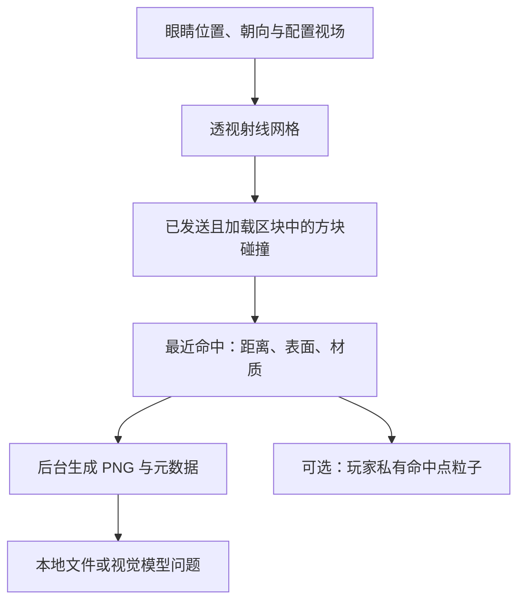

# 🐼 PandaGPT 2.0

为 **Minecraft Java 版 / Paper 26.3** 提供环境感知、射线视觉重建、服务器知识问答，以及需要玩家确认的命令提案。

> 26.3 是 Minecraft/Paper 版本，运行与构建要求 **JDK 25**。本版本不支持原来的 Spigot 1.12.2，也未声明 Folia 兼容性。

## 安装与构建

1. 在 JDK 25 和 Maven 3.9+ 环境执行：
   ```bash
mvn --batch-mode --no-transfer-progress clean verify
```
2. 将 `target/PandaGPT-2.0.0.jar` 放入 Paper 26.3 的 `plugins` 目录，重启服务器。
3. 修改 `plugins/PandaGPT/config.yml`：选择服务商、模型、API 地址与密钥。也可通过服务器进程环境变量 `PANDAGPT_OPENAI_API_KEY` / `PANDAGPT_GEMINI_API_KEY` 提供密钥；非空环境变量优先于文件。
4. 在 `knowledge.md` 中填写本服真实的规则、经济、领地、传送及插件说明。
5. 执行 `/pandaadmin reload`，通过 `/pandaadmin status` 查看所选服务是否已配置。

GitHub Actions 会以 Java 25 运行测试并生成可下载的插件构建产物。Paper API 固定为 `26.3.build.175-stable`，避免构建意外跨入未来版本。更新 Paper 构建时修改 `paper.version` 并重新验证。

## 使用

| 输入 | 行为 |
|---|---|
| `@panda 我附近有哪些危险？` | 根据当前状态及附近实体提供建议 |
| `/panda 我背包里的材料能合成什么？` | 从服务器真实合成配方中查找材料匹配候选 |
| `/panda 本服务器的领地规则是什么？` | 结合服主填写的 knowledge.md 回答 |
| `/panda clear` | 清除个人历史、取消当前请求及待确认动作 |
| `/panda cancel` | 取消待确认动作 |
| `/panda confirm <确认码>` | 执行仍然有效、仍被允许的待确认动作 |
| `/panda ask clear 是什么意思？` | 使用 ask 避开 clear 等子命令名称 |
| `/pandaadmin reload` | 验证后重载配置、知识和配方索引；失败保留原服务 |
| `/pandaadmin clearchat` | 清除全服会话、在途请求及待确认动作 |
| `/pandaadmin status` | 查询配置状态、活动请求和队列大小 |

触发词仅在聊天开头匹配，可写 `panda 问题`、`@panda 问题` 或 `@panda：问题`。不会把普通聊天中间出现的 panda 当成请求。聊天入口尊重其他插件已取消的事件。

## 命令动作

**任何自然语言回复中的 /命令都不会被自动执行。**

动作仅来自模型的结构化工具调用。开启需要同时满足：

- `panda.command_awareness.enabled: true`；
- `allow_execution: true`；
- 命令根名称在 `allowed_commands` 中，且不在拒绝列表中；
- 玩家拥有 `pandagpt.use` 和 `pandagpt.actions`；
- 玩家在有效期内点击确认按钮或输入确认码。

默认仅允许 help，动作执行默认关闭。执行身份只能为 player，绝不赋予 OP 或通过控制台代执行。权限在提案与确认时重新检查；最终由服务器按玩家现有权限派发。命名空间命令、换行和命令串联被拒绝；op、deop、stop、reload、execute、sudo 等管理/包装命令始终被拒绝。

每批动作一次性消费，任何拒绝、失败或权限变化都会停止。确认码与玩家 UUID 绑定，有过期时间，不能重放。Bukkit 的派发返回值只表示命令被接受，不能证明具体游戏动作成功；请查看对应命令的反馈。

允许列表的粒度是命令根名称。服主应审核该命令全部参数与其权限语义；不要加入可以间接执行其他命令的插件包装器。

## 环境和对话

视觉重建详见下方“射线视觉重建与粒子反馈”。

- 游戏状态全部在服务器主线程采集，再把不可变文本快照交给异步请求。
- 自动附加血量、实际最大血量、饥饿、饱和度、位置、维度、天气、时间、光照、完整储物槽物品汇总和装备，无需 personality 占位符。
- 危险/附近问题才查询附近生物，按怪物类别与距离排序，数量有上限；类别不代表实际敌对状态。
- 合成问题使用真实 ShapedRecipe / ShapelessRecipe 索引，按实际物品与数量匹配，不重复使用同一件材料。索引在启动/重载时刷新。
- 配方结果是有限的材料匹配候选，不保证已解锁、已到达工作台或未被其他插件阻止；自定义谓词配方与非合成台配方不在此功能范围。
- 历史以 UUID 隔离，保留完整问答轮次，按字符预算移除较旧的完整轮次。字符预算不等同精确 token 数；未实现长期摘要。
- 每位玩家只允许一个在途请求。全服线程池、队列、会话数量、输入长度、输出 token 和响应体大小都有上限。
- 主线程采集快照 → 有界异步模型请求 → 主线程核对玩家在线状态与会话版本后回复。
- 超时、离线、清除、重载及停服都不会继续向玩家发送旧请求结果。没有自动重试，避免重复计费或重复动作。

## 配置与旧版迁移

首次读入 v1 配置时创建 `config-v1-backup.yml`，保留密钥、模型名、代理和人格配置。旧 `history_size` 是消息数，迁移为向下取整的完整问答轮数；新增配置采用 v2 默认值。

旧 Gemini URL 的 `?key=%s` 不再用于传输密钥；请求使用 API key 头。API 地址必须为 HTTPS，不能带查询参数或 URL 凭据。旧模型名称会保留，服主需自行检查账号当前可用模型并修改；不要假设 2025 年的默认模型仍可使用。

旧 executor 为 op/console 时会明确拒绝配置，需改成 player。默认代理关闭；若使用代理，请确保端口对应 HTTP CONNECT 代理，而非仅支持 SOCKS 的端口。

`logging.enabled` 控制文件日志；默认仅记录 UUID 与事件，`logging.conversations` 可显式开启原始对话日志。日志采用 UTF-8 并轮转。所采集的游戏状态及 knowledge.md 会随请求发送给服主配置的模型端点。

## 权限

| 权限 | 默认 | 用途 |
|---|---|---|
| pandagpt.use | 所有玩家 | 提问与个人会话操作 |
| pandagpt.actions | OP | 提案与确认允许的动作 |
| pandagpt.admin | OP | 重载、状态查询、清除全服会话 |

## 验证范围与后续方向

自动测试覆盖角色请求格式、配置生效、完整问答历史、动作开关、确认与重放、权限撤销、超时、错误响应、离线与清除后的旧回调、会话隔离及队列上限。部署前仍应在独立的 Paper 26.3 测试服上核对插件组合、API 账户和动作白名单。

本版提供方块射线重建；客户端真实截图、实体/纹理渲染和透明层合成仍是后续方向。知识检索目前读取本地小文档，后续可扩展分段检索；不包含自动公告、主动监测或长期记忆摘要。

## 射线视觉重建与粒子反馈

无需客户端模组即可生成第一人称方块几何与材质类别图。它是服务器数据生成的图，不是客户端截图：

```text
/panda vision snapshot
/panda vision snapshot debug
/panda vision ask 我眼前主要有什么方块？哪些区域没有采样到？
/panda vision cancel
```

snapshot 不调用模型 API，可独立验证图像；ask 在采样完成后附加本次 PNG 与重建说明，发送给配置的模型。模型/兼容 API 必须支持图片输入；旧对话只保留文字，不反复发送历史图片。



粒子模块把已经计算出的命中点显示给该玩家；没有把客户端粒子碰撞作为传感器，也没有粒子碰撞回传。debug 需要单独权限，最多显示配置数量的命中点。碰撞数据来自射线检测。

默认按 **160×90、纵向 FOV 70°、最大 96 格**采样，每个像素对应一条透视射线。DDA 逐格检查，单方块精确射线接口负责楼梯、半砖等碰撞形状。不会调用可能加载区块的 World.rayTraceBlocks；只访问采样开始时已发送给玩家且采样时仍加载的区块，并受玩家报告/服务器发送视距限制。首个不可访问区块终止该射线。

每 tick 的射线数量与时间预算由所有任务共享：默认至多 256 条、约 2 ms。时间检查在射线之间，不能抢占单条射线。默认允许两人同时采样，超过 200 ticks 取消。明显移动、转头、离线、清除或重载也会取消任务，因此采样期间请保持位置和视线稳定。

保存位置为 `plugins/PandaGPT/captures/<玩家UUID>/`，每人保留最新一组文件，后续采样覆盖，不公开到 HTTP：

| 文件 | 内容 |
|---|---|
| color.png | 地图基础色、表面方向和方块光照构成的简化场景图 |
| depth.png | 射线距离灰度：近处亮，远处暗；无效像素需结合 mask 判断 |
| labels.png | 材质类别颜色，调色板在 metadata.json |
| metadata.json | 相机参数、采样起止时间、像素距离、材质 ID、有效性 mask 和说明 |

灰色棋盘格表示不可访问数据，蓝色表示范围内没有射线命中，不能把蓝色当成已确认的天空。所有图与元数据使用同一组像素。图中距眼睛的射线距离不等同于相机前向 Z 深度。

**还原边界：**只重建服务器方块碰撞和基础色，不含实体模型、纹理、资源包、光影、HUD、手持物品或第三人称相机。玻璃/水暂按第一层命中处理，花草等视觉模型也可能与碰撞形状不同。服务端不能自动读取客户端真实 FOV、窗口比例、视角摇晃或客户端假方块，请按实际设置调整参数。区块“已发送”不能证明客户端已完成渲染；世界也可能在分 tick 采样期间变化。需要像素级真实画面时应接入客户端截图。

权限 `pandagpt.vision` 和 `pandagpt.vision.debug` 默认均为 OP。文件留在服务器；只有 vision ask 才发送图片给所选模型。关闭 save_images 可只在内存中重建/提问，关闭 vision.enabled 停用整个模块。

官方参考：
- [Paper 运行要求](https://docs.papermc.io/paper/getting-started/)
- [Paper 26.3 项目配置](https://docs.papermc.io/paper/dev/project-setup/)
- [Paper 线程调度](https://docs.papermc.io/paper/dev/scheduler/)
- [单方块射线与碰撞形状](https://jd.papermc.io/paper/26.3/org/bukkit/block/Block.html)
- [玩家已发送区块与粒子接口](https://jd.papermc.io/paper/26.3/org/bukkit/entity/Player.html)
